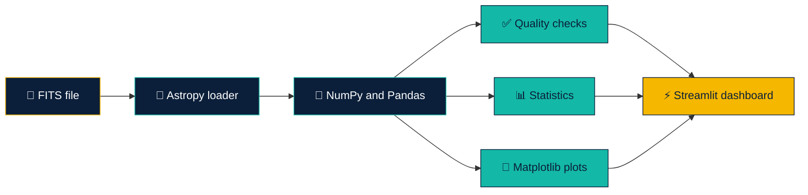
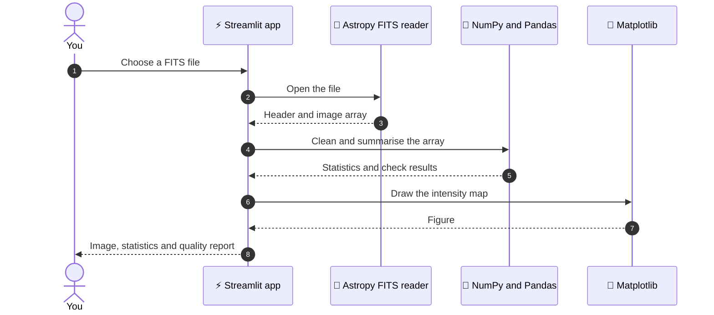
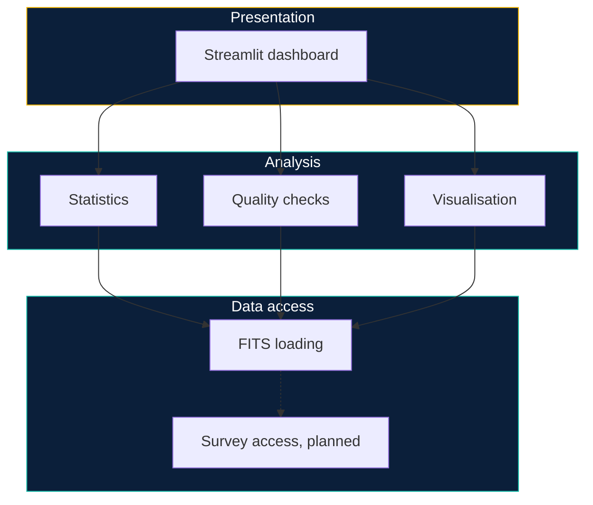
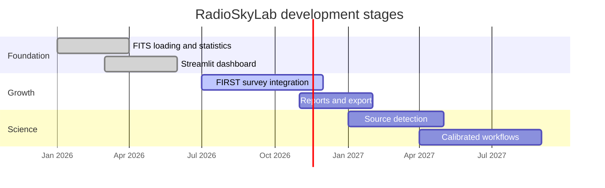

#!/usr/bin/env python3
"""RadioSkyLab README generator.

Run this once from the root of your repository:

    python setup_readme.py

It creates README.md and the animated SVGs in assets/.
Then commit and push. GitHub does not render inline SVG inside a README,
so the three graphics must live as real files, and this script writes them.
"""
from pathlib import Path

FILES = {
    "README.md": r'''<div align="center">


<br/>

<a href="https://git.io/typing-svg">
  
</a>

<br/><br/>


<br/>

[**✨ Features**](#-features) &nbsp;•&nbsp;
[**🧭 How it works**](#-how-it-works) &nbsp;•&nbsp;
[**🖥️ Dashboard**](#%EF%B8%8F-dashboard-tour) &nbsp;•&nbsp;
[**🚀 Quick start**](#-quick-start) &nbsp;•&nbsp;
[**🐍 Python usage**](#-use-the-data-in-python) &nbsp;•&nbsp;
[**📚 Primer**](#-radio-astronomy-primer) &nbsp;•&nbsp;
[**🗺️ Roadmap**](#%EF%B8%8F-roadmap) &nbsp;•&nbsp;
[**❓ FAQ**](#-faq)

</div>


## 📑 Table of contents

<details open>
<summary><b>Click to collapse or expand</b></summary>

<br/>

| # | Section | What you will find |
|:-:|:--------|:-------------------|
| 1 | [🌌 Overview](#-overview) | What RadioSkyLab is and who it is for |
| 2 | [🎬 Demo](#-demo) | A look at the dashboard |
| 3 | [✨ Features](#-features) | Everything the project does today |
| 4 | [🧭 How it works](#-how-it-works) | Pipeline and data flow diagrams |
| 5 | [🖥️ Dashboard tour](#%EF%B8%8F-dashboard-tour) | A walk through the Streamlit app |
| 6 | [🛠️ Technology](#%EF%B8%8F-technology) | The stack and why each tool is here |
| 7 | [📂 Project structure](#-project-structure) | Where things live |
| 8 | [🚀 Quick start](#-quick-start) | Install and run in a few minutes |
| 9 | [🐍 Use the data in Python](#-use-the-data-in-python) | Code examples for FITS files |
| 10 | [📊 Understanding the statistics](#-understanding-the-statistics) | What each number means |
| 11 | [✅ Quality checks](#-quality-checks) | What to look for in your data |
| 12 | [📚 Radio astronomy primer](#-radio-astronomy-primer) | Short guide to the science |
| 13 | [📡 Data and the FIRST survey](#-data-and-the-first-survey) | Where data comes from |
| 14 | [🗺️ Roadmap](#%EF%B8%8F-roadmap) | What is done and what is next |
| 15 | [🧰 Troubleshooting](#-troubleshooting) | Fixes for common problems |
| 16 | [❓ FAQ](#-faq) | Quick answers |
| 17 | [🤝 Contributing](#-contributing) | How to help |
| 18 | [📖 References](#-references-and-credits) | Papers and tools behind the project |
| 19 | [⚠️ Disclaimer](#%EF%B8%8F-disclaimer) | Scientific limits |
| 20 | [👤 Author](#-author) | Who built it |

</details>


## 🌌 Overview

**RadioSkyLab** is a Python-based scientific computing project for **inspecting and analysing radio astronomy FITS images**.

Radio telescopes do not take photographs. They measure faint radio emission from the sky and store it as numbers in files, most often in the **FITS** format. Before any serious science can happen, someone has to open those files, look at the data, and ask a simple question: *is this image any good?*

RadioSkyLab answers that question quickly. You load an observation, see the radio intensity as a picture, read a set of summary statistics, run basic quality checks, and do it all from a clean, interactive dashboard.

### 🎯 Who is it for?

| Audience | How RadioSkyLab helps |
|:---------|:----------------------|
| 🎓 **Students** | Learn what a radio image really contains, using real FITS data |
| 🔬 **Early-career researchers** | Get a fast first look at an observation before deeper processing |
| 🛠️ **Developers** | A readable Python codebase for scientific image analysis |
| 🌍 **Educators and outreach teams** | An interactive way to show how radio data is explored |

### 💡 Design goals

- **Clear.** Every number and every plot should be easy to read and easy to explain.
- **Honest.** Exploratory results are labelled as exploratory. See the [disclaimer](#%EF%B8%8F-disclaimer).
- **Real data first.** Built around real FITS observations, not toy images.
- **Simple to run.** One virtual environment, one install command, one run command.
- **Open to growth.** The structure leaves room for survey integration and calibrated workflows.


## 🎬 Demo

<div align="center">

<!-- 🎬 Record your Streamlit dashboard and save it as docs/demo.gif -->


<sub>📸 Put a screen recording at <code>docs/demo.gif</code> and it appears here.<br/>Tip: keep it under 10 MB and about 10 to 15 seconds long.</sub>

</div>

<details>
<summary><b>🎥 How to record a good demo GIF</b></summary>

<br/>

1. Start the app with `streamlit run app.py`.
2. Open a screen recorder such as **ScreenToGif** (Windows), **Peek** (Linux) or **Kap** (macOS).
3. Record this short story: load a FITS file, show the intensity map, scroll to the statistics, show the quality checks.
4. Export as GIF at about 12 to 15 frames per second and a width near 900 px.
5. Save it as `docs/demo.gif` and commit it.

You can also add still screenshots to `docs/` and link them like this:

```markdown

```

</details>


## ✨ Features

<table>
<tr>
<td width="33%" valign="top">

### 📡 FITS loading

Open real astronomical observations with **Astropy**.

- Reads image data from FITS files
- Works with the standard header and data layout
- Built on the tool the astronomy community already uses

</td>
<td width="33%" valign="top">

### 🌈 Intensity visualisation

See the radio sky as an image with **Matplotlib**.

- Colour-mapped intensity view
- Clear axes and colour bar
- Easy to compare different observations

</td>
<td width="33%" valign="top">

### 📊 Image statistics

Summarise the data with **NumPy** and **Pandas**.

- Central values and spread
- Minimum and maximum
- Tidy tables you can read at a glance

</td>
</tr>
<tr>
<td width="33%" valign="top">

### ✅ Quality checks

Catch problem data early.

- Basic image quality checks
- Helps decide if a file is worth deeper analysis
- Designed to be extended with new checks

</td>
<td width="33%" valign="top">

### ⚡ Streamlit dashboard

Explore without writing code.

- Runs in your browser
- Interactive and responsive
- No notebook setup needed

</td>
<td width="33%" valign="top">

### 🛰️ Survey ready

Prepared for survey data.

- Built for real FITS observations
- **FIRST** survey integration planned
- Astroquery is part of the stack

</td>
</tr>
</table>

### 🧾 Feature summary

| Capability | Status | Powered by |
|:-----------|:------:|:-----------|
| FITS image loading | ✅ Available | Astropy |
| Radio intensity visualisation | ✅ Available | Matplotlib |
| Image statistics | ✅ Available | NumPy, Pandas |
| Basic image quality checks | ✅ Available | NumPy |
| Streamlit dashboard | ✅ Available | Streamlit |
| FIRST survey integration | 🛠️ Planned | Astroquery |
| Calibrated analysis workflows | 🔭 Future | To be decided |


## 🧭 How it works

RadioSkyLab follows a simple pipeline. A FITS file goes in. A set of views and measurements come out.



### 🔁 What happens when you open a file



### 🧱 Layers of the project




## 🖥️ Dashboard tour

The dashboard is meant to be read from top to bottom, the same way you would inspect a new observation by hand.

### Step 1 · Load an observation

Choose a FITS file. RadioSkyLab reads the image data and the header information so you know what you are looking at before you look at the pixels.

### Step 2 · See the radio sky

The intensity map shows how bright the radio emission is across the image. Bright regions are strong emission. Dark regions are weak emission or noise.

### Step 3 · Read the statistics

A compact table summarises the pixel values. Together with the map, it tells you whether the image looks like a sensible observation.

### Step 4 · Check quality

Basic quality checks flag common problems, so you can decide whether the file is ready for deeper work.

### 🗺️ Where to look first

| If you want to know... | Look at... |
|:-----------------------|:-----------|
| Does the image look like a real observation? | The intensity map |
| How bright is the brightest pixel? | The maximum in the statistics table |
| Is the background quiet? | The spread of values away from bright sources |
| Is anything broken in the file? | The quality checks |
| Where did this file come from? | The header information |

<details>
<summary><b>🧭 A good first-look routine (30 seconds)</b></summary>

<br/>

1. Does the map show structure, or is it flat or noisy everywhere?
2. Are the minimum and maximum values reasonable for the instrument?
3. Do the quality checks report anything unusual?
4. If something looks wrong, check the header before blaming the data.

</details>


## 🛠️ Technology

<div align="center">


</div>

| Tool | Role in RadioSkyLab | Why it is here |
|:-----|:--------------------|:---------------|
| 🐍 **Python** | Core language | Readable, and the standard language of modern astronomy software |
| ⚡ **Streamlit** | Dashboard | Turns Python scripts into interactive web apps quickly |
| 🔭 **Astropy** | FITS and astronomy utilities | The community standard for working with astronomical data in Python |
| 🧮 **NumPy** | Array maths | Fast numerical operations on image arrays |
| 🐼 **Pandas** | Tables | Clean summaries and tidy display of results |
| 📈 **Matplotlib** | Plotting | Full control over scientific figures |
| 🛰️ **Astroquery** | Survey access | Planned route to online archives such as the FIRST survey |

### 🧩 How the pieces fit together

```text
        ┌───────────────┐
        │   Streamlit   │   interface
        └───────┬───────┘
                │
   ┌────────────┼─────────────┐
   │            │             │
┌──▼───┐    ┌───▼────┐    ┌───▼──────┐
│Pandas│    │ NumPy  │    │Matplotlib│   analysis and plots
└──┬───┘    └───┬────┘    └───┬──────┘
   └────────────┼─────────────┘
                │
        ┌───────▼───────┐
        │    Astropy    │   FITS reading
        └───────┬───────┘
                │
        ┌───────▼───────┐
        │  FITS files   │   your data
        └───────────────┘
```


## 📂 Project structure

A recommended layout for the repository. Adjust the names to match your own files.

```text
RadioSkyLab/
├── 📄 app.py                 # Streamlit entry point
├── 📄 requirements.txt       # Python dependencies
├── 📄 README.md              # You are here
├── 📁 assets/                # README header, divider and footer graphics
│   ├── header.svg
│   ├── divider.svg
│   └── footer.svg
├── 📁 docs/                  # Screenshots and the demo GIF
│   └── demo.gif
├── 📁 data/                  # Your FITS files (keep large files out of Git)
│   └── .gitkeep
└── 📁 tests/                 # Optional: automated tests
```

### 📝 Notes on the layout

- Keep **large FITS files out of Git**. Add them to `.gitignore` and share them through a data host instead.
- Keep the README graphics in `assets/` so the page loads fast and works offline on GitHub.
- Screenshots and GIFs belong in `docs/`.

<details>
<summary><b>📄 Suggested <code>.gitignore</code></b></summary>

<br/>

```gitignore
# Python
__pycache__/
*.pyc
.venv/
.env

# Data (large files)
data/*.fits
data/*.fits.gz

# Jupyter and editors
.ipynb_checkpoints/
.vscode/
.idea/

# OS files
.DS_Store
Thumbs.db
```

</details>


## 🚀 Quick start

### ✅ Requirements

| Requirement | Notes |
|:------------|:------|
| Python | 3.9 or newer is recommended |
| Git | To clone the repository |
| A FITS file | Any radio astronomy image works. See [Data](#-data-and-the-first-survey) |
| A modern browser | The dashboard runs in the browser |

### 1️⃣ Clone the repository

```bash
git clone YOUR_REPOSITORY_URL
cd RadioSkyLab
```

### 2️⃣ Create a virtual environment

```bash
python -m venv .venv
```

### 3️⃣ Activate it

<table>
<tr>
<th>🪟 Windows (PowerShell or CMD)</th>
<th>🐧 macOS and Linux</th>
</tr>
<tr>
<td>

```bash
.venv\Scripts\activate
```

</td>
<td>

```bash
source .venv/bin/activate
```

</td>
</tr>
</table>

> 💡 You know it worked when your terminal prompt starts with `(.venv)`.

### 4️⃣ Install dependencies

```bash
pip install -r requirements.txt
```

### 5️⃣ Run the dashboard

```bash
streamlit run app.py
```

Streamlit prints a local address, usually:

```text
Local URL: http://localhost:8501
```

Open it in your browser and the dashboard is ready.

### ⏱️ The whole thing in one block

```bash
git clone YOUR_REPOSITORY_URL
cd RadioSkyLab
python -m venv .venv
.venv\Scripts\activate          # Windows
# source .venv/bin/activate     # macOS or Linux
pip install -r requirements.txt
streamlit run app.py
```

### 📦 Example `requirements.txt`

If you need to create or check your requirements file, this is the stack the project uses:

```text
streamlit
astropy
numpy
pandas
matplotlib
astroquery
```

> 📌 For reproducible installs, pin versions with `pip freeze > requirements.txt` once everything works.


## 🐍 Use the data in Python

You do not have to use the dashboard. These examples show how the same ideas work in a few lines of plain Python with Astropy and NumPy. They are a good way to understand what the dashboard is doing.

### 📥 Open a FITS file

```python
from astropy.io import fits

with fits.open("data/my_observation.fits") as hdul:
    hdul.info()                      # list the parts of the file
    header = hdul[0].header          # metadata
    data = hdul[0].data              # the image array

print(data.shape)
```

### 🧐 Read the header

```python
for key in ("OBJECT", "TELESCOP", "INSTRUME", "BUNIT", "CRVAL1", "CRVAL2"):
    print(key, "=", header.get(key, "not present"))
```

> Not every file has every key. Using `.get()` keeps your code from crashing when one is missing.

### 🧹 Handle extra dimensions

Radio images often carry extra axes for frequency and polarisation. Reduce them to a plain 2D image first.

```python
import numpy as np

image = np.squeeze(data)             # drop axes of length 1

while image.ndim > 2:                # keep the first plane of any remaining axes
    image = image[0]

print(image.shape)                   # now (rows, columns)
```

### 📊 Basic statistics

```python
import numpy as np

stats = {
    "min":    np.nanmin(image),
    "max":    np.nanmax(image),
    "mean":   np.nanmean(image),
    "median": np.nanmedian(image),
    "std":    np.nanstd(image),
}

for name, value in stats.items():
    print(f"{name:>7}: {value:.6g}")
```

### 🧾 Put the numbers in a table

```python
import pandas as pd

table = pd.DataFrame(
    {"statistic": list(stats.keys()), "value": list(stats.values())}
)
print(table.to_string(index=False))
```

### 🌈 Plot the intensity map

```python
import matplotlib.pyplot as plt

fig, ax = plt.subplots(figsize=(7, 6))

low, high = np.nanpercentile(image, [1, 99.5])     # ignore extreme pixels
im = ax.imshow(image, origin="lower", cmap="inferno", vmin=low, vmax=high)

fig.colorbar(im, ax=ax, label="Intensity")
ax.set_title("Radio intensity")
ax.set_xlabel("Pixel x")
ax.set_ylabel("Pixel y")
plt.show()
```

### 🔍 A few simple sanity checks

```python
n_total = image.size
n_nan = int(np.isnan(image).sum())
n_inf = int(np.isinf(image).sum())

print(f"Total pixels : {n_total}")
print(f"NaN pixels   : {n_nan} ({100 * n_nan / n_total:.2f}%)")
print(f"Inf pixels   : {n_inf}")
print(f"All zeros    : {bool(np.all(image == 0))}")
print(f"Constant     : {bool(np.nanmin(image) == np.nanmax(image))}")
```

### 📈 Look at the pixel value distribution

```python
values = image[np.isfinite(image)].ravel()

fig, ax = plt.subplots(figsize=(7, 4))
ax.hist(values, bins=200, log=True, color="#14B8A6")
ax.set_xlabel("Pixel value")
ax.set_ylabel("Count (log scale)")
ax.set_title("Distribution of pixel values")
plt.show()
```

> 🧠 In a good radio image, most pixels are noise that clusters around zero. A long tail toward high values is usually real sources.

<details>
<summary><b>🛰️ Planned: fetching survey data with Astroquery</b></summary>

<br/>

Survey integration is **not part of the current release**. Astroquery provides tools to reach online archives and is part of the stack so the project is ready for this step. Check the [Astroquery documentation](https://astroquery.readthedocs.io/) for the services available when you reach that stage.

</details>


## 📊 Understanding the statistics

Every statistic tells part of the story. None of them tells all of it.

| Statistic | Plain-language meaning | What to watch for |
|:----------|:-----------------------|:------------------|
| **Minimum** | The faintest or most negative pixel | Very large negative values can point to artefacts |
| **Maximum** | The brightest pixel | A single huge value can be a real bright source or a glitch |
| **Mean** | The average of all pixels | Pulled upward by bright sources |
| **Median** | The middle pixel value | A better picture of the typical background |
| **Standard deviation** | How spread out the values are | Mixes noise and real sources together |

### 🧮 Why mean and median can differ

Most of a radio image is background noise. A few pixels hold bright sources. Those few bright pixels pull the **mean** upward but barely move the **median**. If the two are far apart, the image probably contains strong sources or artefacts.

```text
  background noise                bright source
 ░░░░░░░░░░░░░░░░░░░░░░░░░░░░░░░░░░░░░░░░░░░░ ███
 └────────── median sits here ──────────────┘  └─ mean is pulled this way
```

### 📏 A rule of thumb for noise

Noise can be estimated from a patch of sky that has no obvious sources. The standard deviation of that patch is a simple first estimate of the **noise level**. The whole-image standard deviation is usually larger because it includes the sources.

```python
patch = image[10:110, 10:110]               # choose a quiet corner by eye
noise = np.nanstd(patch)
peak = np.nanmax(image)

print(f"Noise estimate : {noise:.6g}")
print(f"Peak           : {peak:.6g}")
print(f"Peak / noise   : {peak / noise:.1f}")
```

### 🧯 What the statistics cannot tell you

- They do not tell you whether the **flux scale** is correct.
- They do not tell you whether a feature is a **real source** or an artefact.
- They do not replace proper **calibration and imaging**.

See the [disclaimer](#%EF%B8%8F-disclaimer).


## ✅ Quality checks

Basic quality checks give you a fast, rough sense of whether an image is usable. The list below describes the kinds of problems worth looking for when you inspect a radio image. Use it alongside the dashboard.

| Problem | Why it matters | Typical sign |
|:--------|:---------------|:-------------|
| 🕳️ **Missing pixels** (NaN) | Statistics can be wrong or fail | Blank patches or edges in the map |
| ♾️ **Infinite values** | Break plots and averages | Extreme scale on the colour bar |
| 🟫 **Empty image** | Nothing to analyse | All values equal or all zero |
| 📏 **Wrong shape** | Extra axes confuse tools | More than two dimensions |
| 🔊 **Very high noise** | Hides faint sources | Grainy map, huge spread |
| 📈 **Extreme outliers** | Skew the colour scale | One pixel far above all others |
| 🧩 **Edge artefacts** | Common in mosaics and cutouts | Bright or dark borders |

### 🚦 Reading the result

| Outcome | What it means | Suggested action |
|:-------:|:--------------|:-----------------|
| 🟢 **Looks fine** | No obvious problems found | Continue to deeper analysis |
| 🟡 **Warnings** | Something unusual was found | Inspect the map and header before trusting numbers |
| 🔴 **Problems** | Data may be unusable | Re-download, re-process or choose another file |

> ⚠️ A passing result does **not** prove the data is scientifically valid. It only means that nothing obviously wrong was found.

### 🧪 Try the checks yourself

```python
def quick_checks(image):
    """Return a few simple facts about a 2D image."""
    total = image.size
    return {
        "shape": image.shape,
        "nan_fraction": float(np.isnan(image).sum()) / total,
        "inf_count": int(np.isinf(image).sum()),
        "is_constant": bool(np.nanmin(image) == np.nanmax(image)),
        "dynamic_range": float(np.nanmax(image) - np.nanmin(image)),
    }

print(quick_checks(image))
```


## 📚 Radio astronomy primer

A short guide for readers who are new to the science.

### 📡 What is radio astronomy?

Radio astronomy studies the universe through radio waves. These are the same kind of electromagnetic waves used for broadcasting, but at wavelengths and strengths that come from stars, galaxies, black holes and clouds of gas. Radio waves pass through dust and clouds, so they reveal things that visible light hides.

### 🗂️ What is a FITS file?

**FITS** stands for **Flexible Image Transport System**. It is the standard file format in astronomy. A FITS file holds:

| Part | Contents |
|:-----|:---------|
| **Header** | Text metadata: telescope, object, units, coordinates, dates |
| **Data** | The numbers themselves, usually an image array |
| **Extensions** | Extra tables or images stored in the same file |

### 🔤 Words you will meet

| Term | Meaning |
|:-----|:--------|
| **Intensity** | How strong the radio emission is at each point |
| **Flux density** | Radio power per area per frequency, often measured in **Jansky (Jy)** |
| **Jy/beam** | A common radio image unit: flux density per telescope beam |
| **Beam** | The telescope's resolution element, like the blur of the instrument |
| **Noise (RMS)** | The random variation in the image, set by the instrument and the observation |
| **Dynamic range** | Brightest signal compared with the noise level |
| **Source** | A real object that emits radio waves |
| **Artefact** | A false feature created by the instrument or the processing |
| **WCS** | World Coordinate System: maps pixels to positions on the sky |
| **Calibration** | Correcting measurements so they reflect true physical values |
| **Imaging** | Turning raw telescope measurements into a picture of the sky |
| **RFI** | Radio frequency interference: unwanted human-made signals |

### 🌠 Why the picture is not a photograph

A radio image is built from measurements, then processed with careful mathematics. The result depends on how the data was calibrated and imaged. That is why the same patch of sky can look different in two images, and why RadioSkyLab treats its own measurements as exploratory.

### 🧭 The journey from sky to screen


## 📡 Data and the FIRST survey

RadioSkyLab is designed to support **real astronomical FITS observations**.

### 🛰️ What is the FIRST survey?

**FIRST** stands for **Faint Images of the Radio Sky at Twenty-Centimeters**. It is a large radio survey made with the Very Large Array in the United States. It maps a big part of the sky at a wavelength of about 20 cm and is widely used for finding and studying radio sources.

> 🚧 **Status:** FIRST survey integration will be added in a subsequent development stage.

### 🧭 Plan for survey integration


### 📥 Using your own data today

Until survey integration arrives, bring your own files:

1. Place your FITS file in the `data/` folder.
2. Start the dashboard.
3. Select the file and explore.

### 🧷 Data etiquette

- Respect the **licence and citation rules** of every dataset you use.
- Never commit large or restricted data to a public repository.
- Credit the telescope, survey and authors in anything you publish.


## 🗺️ Roadmap

### ✅ Done

- [x] FITS image loading with Astropy
- [x] Radio intensity visualisation
- [x] Image statistics
- [x] Basic image quality checks
- [x] Streamlit dashboard

### 🛠️ Next

- [ ] FIRST survey integration with Astroquery
- [ ] Sky position search and cutout download
- [ ] Better handling of multi-axis FITS files
- [ ] Export statistics and reports

### 🔭 Later

- [ ] Source detection and simple source tables
- [ ] Noise map and signal-to-noise view
- [ ] Coordinate overlays using the image WCS
- [ ] Support for calibrated analysis workflows
- [ ] Automated tests and continuous integration

### 🧭 Timeline



> 🗓️ The dates above are a planning sketch. Update them to match your real schedule.


## 🧰 Troubleshooting

<details>
<summary><b>❌ <code>streamlit: command not found</code></b></summary>

<br/>

Your virtual environment is probably not active, or the install did not finish.

```bash
# Windows
.venv\Scripts\activate

# macOS or Linux
source .venv/bin/activate

pip install -r requirements.txt
```

You can also run Streamlit as a module:

```bash
python -m streamlit run app.py
```

</details>

<details>
<summary><b>🔒 PowerShell blocks the activate script</b></summary>

<br/>

Windows can block scripts by default. Allow them for your user only:

```powershell
Set-ExecutionPolicy -Scope CurrentUser -ExecutionPolicy RemoteSigned
```

Or activate with Command Prompt instead:

```bat
.venv\Scripts\activate.bat
```

</details>

<details>
<summary><b>📦 <code>ModuleNotFoundError: No module named 'astropy'</code></b></summary>

<br/>

The package is missing from the active environment.

```bash
pip install astropy
```

Check that you are inside the right environment:

```bash
python -c "import sys; print(sys.executable)"
```

The path should point inside your `.venv` folder.

</details>

<details>
<summary><b>🗂️ The FITS file will not open</b></summary>

<br/>

- Confirm the file is a real FITS file and finished downloading.
- Compressed files such as `.fits.gz` usually open directly with Astropy.
- Try listing the file contents with `hdul.info()` to see which extension holds the image.
- Some files keep the image in extension `1` rather than `0`.

```python
with fits.open("data/file.fits") as hdul:
    hdul.info()
    data = hdul[1].data      # try the next extension
```

</details>

<details>
<summary><b>🧊 The image looks blank or completely black</b></summary>

<br/>

- A few extreme pixels can stretch the colour scale. Clip the display range with percentiles, as shown in the [plotting example](#-use-the-data-in-python).
- Check for `NaN` values and for an image that is all zeros.
- Make sure you are viewing a 2D plane, not a collapsed or empty axis.

</details>

<details>
<summary><b>🐢 The app is slow with big files</b></summary>

<br/>

- Large images take time to load and plot. Try a smaller cutout first.
- Reduce the image before plotting if you only need a quick look.
- Close other heavy programs and restart the app.

</details>

<details>
<summary><b>🌐 The dashboard does not open in my browser</b></summary>

<br/>

- Copy the `Local URL` that Streamlit prints into your browser.
- If port `8501` is busy, pick another one:

```bash
streamlit run app.py --server.port 8502
```

</details>

<details>
<summary><b>🔌 A command fails because of the network</b></summary>

<br/>

Survey and archive access needs an internet connection. Check your connection and any firewall or proxy settings, then try again.

</details>


## ❓ FAQ

<details>
<summary><b>Do I need a telescope or special equipment?</b></summary>

<br/>

No. You only need a computer and a FITS file. Public radio data is available from many observatories and surveys.

</details>

<details>
<summary><b>Which FITS files work best?</b></summary>

<br/>

Calibrated image files, where the data is a 2D map of the sky or a stack that reduces to one. Raw measurement files are not images and need processing first.

</details>

<details>
<summary><b>Can I use it for research papers?</b></summary>

<br/>

RadioSkyLab gives **exploratory** measurements. For published results, use calibrated, peer-reviewed tools and methods, and cite your data sources properly.

</details>

<details>
<summary><b>Why are the statistics only "exploratory"?</b></summary>

<br/>

Because they are computed directly from pixel values, without calibration-aware treatment of beam, noise structure or source models. They are great for a first look and not enough for final science.

</details>

<details>
<summary><b>Is the FIRST survey available now?</b></summary>

<br/>

Not yet. It is planned for a later development stage. See the [roadmap](#%EF%B8%8F-roadmap).

</details>

<details>
<summary><b>Can I add my own checks or plots?</b></summary>

<br/>

Yes. The project is meant to grow. Add a function that takes a 2D array and returns a result, then show it in the dashboard.

</details>

<details>
<summary><b>Does it work on Windows, macOS and Linux?</b></summary>

<br/>

Yes. The stack is cross-platform. Only the virtual environment activation command differs. See the [quick start](#-quick-start).

</details>

<details>
<summary><b>How do I update to the latest version?</b></summary>

<br/>

```bash
git pull
pip install -r requirements.txt --upgrade
```

</details>


## 🤝 Contributing

Ideas, bug reports and improvements are welcome.

### 🧭 Ways to help

| You can... | How |
|:-----------|:----|
| 🐞 Report a bug | Open an issue with steps to reproduce and the error message |
| 💡 Suggest a feature | Open an issue describing the problem it would solve |
| 📝 Improve the docs | Fix typos, add examples, clarify steps |
| 🧪 Add tests | Small, focused tests are very welcome |
| 🔭 Share data tips | Point to open FITS datasets that work well |

### 🔧 Development workflow

```bash
# 1. Fork the repository on GitHub, then clone your fork
git clone YOUR_FORK_URL
cd RadioSkyLab

# 2. Create a branch
git checkout -b feature/my-improvement

# 3. Set up the environment
python -m venv .venv
.venv\Scripts\activate           # Windows
# source .venv/bin/activate      # macOS or Linux
pip install -r requirements.txt

# 4. Make your changes and run the app to test them
streamlit run app.py

# 5. Commit and push
git add .
git commit -m "Describe your change"
git push origin feature/my-improvement
```

Then open a **pull request** and describe what you changed and why.

### 🧼 Style guide

- Write clear, readable Python with helpful names.
- Add short docstrings to functions.
- Keep functions small and focused on one job.
- Explain any science in comments so students can follow along.
- Label results honestly as exploratory unless they are properly calibrated.

### 🏷️ Commit message ideas

| Prefix | Use for |
|:-------|:--------|
| `feat:` | A new feature |
| `fix:` | A bug fix |
| `docs:` | Documentation only |
| `refactor:` | Code cleanup with no behaviour change |
| `test:` | Adding or updating tests |


## 📖 References and credits

RadioSkyLab stands on the work of the open-source and astronomy communities.

### 🧰 Software

| Project | Link |
|:--------|:-----|
| Astropy | [astropy.org](https://www.astropy.org/) |
| Astroquery | [astroquery.readthedocs.io](https://astroquery.readthedocs.io/) |
| Streamlit | [streamlit.io](https://streamlit.io/) |
| NumPy | [numpy.org](https://numpy.org/) |
| Pandas | [pandas.pydata.org](https://pandas.pydata.org/) |
| Matplotlib | [matplotlib.org](https://matplotlib.org/) |

### 📄 Papers worth citing

If you use these tools or data in published work, please cite the original papers.

- Becker, R. H., White, R. L., & Helfand, D. J. (1995). *The FIRST Survey: Faint Images of the Radio Sky at Twenty Centimeters.* The Astrophysical Journal, 450, 559.
- Astropy Collaboration (2013). *Astropy: A community Python package for astronomy.* Astronomy & Astrophysics, 558, A33.
- Astropy Collaboration (2018). *The Astropy Project: Building an open-science project and status of the v2.0 core package.* The Astronomical Journal, 156, 123.
- Astropy Collaboration (2022). *The Astropy Project: Sustaining and growing a community-oriented open-source project and the latest major release (v5.0) of the core package.* The Astrophysical Journal, 935, 167.
- Ginsburg, A., et al. (2019). *astroquery: An Astronomical Web-querying Package in Python.* The Astronomical Journal, 157, 98.

### 🎨 Visual credits

- Header, divider and footer graphics are custom animated SVGs stored in `assets/`.
- Badges by [Shields.io](https://shields.io/).
- Typing animation by [readme-typing-svg](https://github.com/DenverCoder1/readme-typing-svg).
- Technology icons by [skillicons.dev](https://skillicons.dev/).


## ⚠️ Disclaimer

> **Basic image statistics are exploratory measurements, not a substitute for scientifically calibrated radio astronomy analysis.**

RadioSkyLab is built for learning, inspection and first-look analysis. It does not replace calibrated pipelines, expert review or peer-reviewed methods. Always confirm important findings with established tools and cite your data sources.


## 👤 Author

<div align="center">

### **Luthando Candlovu**

`Computer Science` &nbsp;•&nbsp; `Scientific Computing` &nbsp;•&nbsp; `Radio Astronomy` &nbsp;•&nbsp; `AI`

<br/>

[](https://github.com/LuthandoCandlovu)

<br/>


<br/><br/>

⭐ **If RadioSkyLab helped you, give the repository a star.** ⭐

<br/>


</div>
''',
    "assets/header.svg": r'''<svg xmlns="http://www.w3.org/2000/svg" viewBox="0 0 1200 380" width="1200" height="380" role="img" aria-labelledby="t d" xmlns:c2pa="http://c2pa.org/manifest"><metadata><c2pa:manifest>AAAWgmp1bWIAAAAeanVtZGMycGEAEQAQgAAAqgA4m3EDYzJwYQAAABZcanVtYgAAAEdqdW1kYzJtYQARABCAAACqADibcQN1cm46YzJwYTo1NTkxNTdkYS01MjAyLTRiNGQtYTgxOC0yOTM0NDcwZTYxMDgAAAADl2p1bWIAAAApanVtZGMyYXMAEQAQgAAAqgA4m3EDYzJwYS5hc3NlcnRpb25zAAAAALxqdW1iAAAARGp1bWRjYm9yABEAEIAAAKoAOJtxE2MycGEuaW5ncmVkaWVudC52MwAAAAAYYzJzaJ9Z+39GJLoR2FO3zYKCp4cAAABwY2JvcqNpZGM6Zm9ybWF0bWltYWdlL3N2Zyt4bWxqaW5zdGFuY2VJRHgseG1wOmlpZDpmZWU5NGNhZS1hZmJhLTRiMDctODg2NC03ZTVlNWQxZTgxMWVscmVsYXRpb25zaGlwaHBhcmVudE9mAAAB4mp1bWIAAABBanVtZGNib3IAEQAQgAAAqgA4m3ETYzJwYS5hY3Rpb25zLnYyAAAAABhjMnNoNdJn51msW4thkbYolZNEZwAAAZljYm9yomdhY3Rpb25zgqJmYWN0aW9ua2MycGEub3BlbmVkanBhcmFtZXRlcnOha2luZ3JlZGllbnRzgaJjdXJseC1zZWxmI2p1bWJmPWMycGEuYXNzZXJ0aW9ucy9jMnBhLmluZ3JlZGllbnQudjNkaGFzaFggQXxknQZHFjqsSsNf/Xv9l5j8ILZZVRdvXasqgQZ97iqkZmFjdGlvbngdY29tLmFudGhyb3BpYy5jbGF1ZGUucHJvdmlkZWRqcGFyYW1ldGVyc6F4H2NvbS5hbnRocm9waWMub3JpZ2luLWNvbmZpZGVuY2VndW5rbm93bmtkZXNjcmlwdGlvbnhmQ2xhdWRlIHByb3ZpZGVkIHRoaXMgZmlsZSBhdCB0aGUgcmVxdWVzdCBvZiBhIHVzZXIgYW5kIG1heSBoYXZlIGNyZWF0ZWQgb3IgbW9kaWZpZWQgdGhlIGZpbGUgY29udGVudHMubXNvZnR3YXJlQWdlbnShZG5hbWVmQ2xhdWRlcmFsbEFjdGlvbnNJbmNsdWRlZPUAAADIanVtYgAAAEBqdW1kY2JvcgARABCAAACqADibcRNjMnBhLmhhc2guZGF0YQAAAAAYYzJzaIZVYbAFNax6UjEzFJn3dPcAAACAY2JvcqVjYWxnZnNoYTI1NmNwYWRNAAAAAAAAAAAAAAAAAGRoYXNoWCA+ltosCD7ScUW2EsBC3R91/hsxdOCsA6zUfkg/w5vw+GRuYW1lbmp1bWJmIG1hbmlmZXN0amV4Y2x1c2lvbnOBomVzdGFydBi5Zmxlbmd0aBkeBAAAAj5qdW1iAAAAJ2p1bWRjMmNsABEAEIAAAKoAOJtxA2MycGEuY2xhaW0udjIAAAACD2Nib3KlY2FsZ2ZzaGEyNTZpc2lnbmF0dXJleE1zZWxmI2p1bWJmPS9jMnBhL3VybjpjMnBhOjU1OTE1N2RhLTUyMDItNGI0ZC1hODE4LTI5MzQ0NzBlNjEwOC9jMnBhLnNpZ25hdHVyZWppbnN0YW5jZUlEeCx4bXA6aWlkOjMwZTU5NjI5LWY1Y2ItNDcxOC1hYmI3LTcyNGNkOGJhNjJjNXJjcmVhdGVkX2Fzc2VydGlvbnODomN1cmx4LXNlbGYjanVtYmY9YzJwYS5hc3NlcnRpb25zL2MycGEuaW5ncmVkaWVudC52M2RoYXNoWCBBfGSdBkcWOqxKw1/9e/2XmPwgtllVF29dqyqBBn3uKqJjdXJseCpzZWxmI2p1bWJmPWMycGEuYXNzZXJ0aW9ucy9jMnBhLmFjdGlvbnMudjJkaGFzaFggOeNjE02gtCVFS3akMovKYReKqZ1HVQglvcpCCMoDKKSiY3VybHgpc2VsZiNqdW1iZj1jMnBhLmFzc2VydGlvbnMvYzJwYS5oYXNoLmRhdGFkaGFzaFggWaLIDey1ElVxZxc3iD8gc73cLftU2veMiaxyLbyoGx90Y2xhaW1fZ2VuZXJhdG9yX2luZm+jZG5hbWVvQW50aHJvcGljIEZpbGVzZ3ZlcnNpb25lMS4wLjBrc3BlY1ZlcnNpb25lMi40LjAAABA4anVtYgAAAChqdW1kYzJjcwARABCAAACqADibcQNjMnBhLnNpZ25hdHVyZQAAABAIY2JvctKEWQISogEmGCFZAgowggIGMIIBjaADAgECAhRA5aAK7sI50L64g/oGQgU9Z1UTADAKBggqhkjOPQQDAzBJMRcwFQYDVQQKEw5BbnRocm9waWMsIFBCQzEuMCwGA1UEAxMlQW50aHJvcGljIENvbnRlbnQgQ3JlZGVudGlhbHMgUm9vdCBDQTAeFw0yNjA4MDcxODQzNTZaFw0yODA4MDYxOTQzNTZaMEQxFzAVBgNVBAoTDkFudGhyb3BpYywgUEJDMSkwJwYDVQQDEyBBbnRocm9waWMgQ2xhdWRlIENvbnRlbnQgU2lnbmluZzBZMBMGByqGSM49AgEGCCqGSM49AwEHA0IABJh6CmvLUBgFFNU0vUKlOVtE6djd17L5SuwX0LemFisBM3dkd/3cyjxFA3Qo5S46fX0/ihY0VZ7mfb9KF703t5OjWDBWMA4GA1UdDwEB/wQEAwIHgDAVBgNVHSUEDjAMBgorBgEEAYPoXgIBMAwGA1UdEwEB/wQCMAAwHwYDVR0jBBgwFoAUzlHiBIFOZFsj+OPEz5o+nMHXXMIwCgYIKoZIzj0EAwMDZwAwZAIwMXMdFJ4BetLLVY7ORuE9noqbbAZOZn/aArXyTwFAZfKrPzxF2vPoJNf1+UCdg1XGAjBwX1zd9WGqYkqmL5SFqw1QySjr1zJfpJM9+1rdDwSPLMOPOjKuiXjoU/pUUeG9RwmhY3BhZFkNngAAAAAAAAAAAAAAAAAAAAAAAAAAAAAAAAAAAAAAAAAAAAAAAAAAAAAAAAAAAAAAAAAAAAAAAAAAAAAAAAAAAAAAAAAAAAAAAAAAAAAAAAAAAAAAAAAAAAAAAAAAAAAAAAAAAAAAAAAAAAAAAAAAAAAAAAAAAAAAAAAAAAAAAAAAAAAAAAAAAAAAAAAAAAAAAAAAAAAAAAAAAAAAAAAAAAAAAAAAAAAAAAAAAAAAAAAAAAAAAAAAAAAAAAAAAAAAAAAAAAAAAAAAAAAAAAAAAAAAAAAAAAAAAAAAAAAAAAAAAAAAAAAAAAAAAAAAAAAAAAAAAAAAAAAAAAAAAAAAAAAAAAAAAAAAAAAAAAAAAAAAAAAAAAAAAAAAAAAAAAAAAAAAAAAAAAAAAAAAAAAAAAAAAAAAAAAAAAAAAAAAAAAAAAAAAAAAAAAAAAAAAAAAAAAAAAAAAAAAAAAAAAAAAAAAAAAAAAAAAAAAAAAAAAAAAAAAAAAAAAAAAAAAAAAAAAAAAAAAAAAAAAAAAAAAAAAAAAAAAAAAAAAAAAAAAAAAAAAAAAAAAAAAAAAAAAAAAAAAAAAAAAAAAAAAAAAAAAAAAAAAAAAAAAAAAAAAAAAAAAAAAAAAAAAAAAAAAAAAAAAAAAAAAAAAAAAAAAAAAAAAAAAAAAAAAAAAAAAAAAAAAAAAAAAAAAAAAAAAAAAAAAAAAAAAAAAAAAAAAAAAAAAAAAAAAAAAAAAAAAAAAAAAAAAAAAAAAAAAAAAAAAAAAAAAAAAAAAAAAAAAAAAAAAAAAAAAAAAAAAAAAAAAAAAAAAAAAAAAAAAAAAAAAAAAAAAAAAAAAAAAAAAAAAAAAAAAAAAAAAAAAAAAAAAAAAAAAAAAAAAAAAAAAAAAAAAAAAAAAAAAAAAAAAAAAAAAAAAAAAAAAAAAAAAAAAAAAAAAAAAAAAAAAAAAAAAAAAAAAAAAAAAAAAAAAAAAAAAAAAAAAAAAAAAAAAAAAAAAAAAAAAAAAAAAAAAAAAAAAAAAAAAAAAAAAAAAAAAAAAAAAAAAAAAAAAAAAAAAAAAAAAAAAAAAAAAAAAAAAAAAAAAAAAAAAAAAAAAAAAAAAAAAAAAAAAAAAAAAAAAAAAAAAAAAAAAAAAAAAAAAAAAAAAAAAAAAAAAAAAAAAAAAAAAAAAAAAAAAAAAAAAAAAAAAAAAAAAAAAAAAAAAAAAAAAAAAAAAAAAAAAAAAAAAAAAAAAAAAAAAAAAAAAAAAAAAAAAAAAAAAAAAAAAAAAAAAAAAAAAAAAAAAAAAAAAAAAAAAAAAAAAAAAAAAAAAAAAAAAAAAAAAAAAAAAAAAAAAAAAAAAAAAAAAAAAAAAAAAAAAAAAAAAAAAAAAAAAAAAAAAAAAAAAAAAAAAAAAAAAAAAAAAAAAAAAAAAAAAAAAAAAAAAAAAAAAAAAAAAAAAAAAAAAAAAAAAAAAAAAAAAAAAAAAAAAAAAAAAAAAAAAAAAAAAAAAAAAAAAAAAAAAAAAAAAAAAAAAAAAAAAAAAAAAAAAAAAAAAAAAAAAAAAAAAAAAAAAAAAAAAAAAAAAAAAAAAAAAAAAAAAAAAAAAAAAAAAAAAAAAAAAAAAAAAAAAAAAAAAAAAAAAAAAAAAAAAAAAAAAAAAAAAAAAAAAAAAAAAAAAAAAAAAAAAAAAAAAAAAAAAAAAAAAAAAAAAAAAAAAAAAAAAAAAAAAAAAAAAAAAAAAAAAAAAAAAAAAAAAAAAAAAAAAAAAAAAAAAAAAAAAAAAAAAAAAAAAAAAAAAAAAAAAAAAAAAAAAAAAAAAAAAAAAAAAAAAAAAAAAAAAAAAAAAAAAAAAAAAAAAAAAAAAAAAAAAAAAAAAAAAAAAAAAAAAAAAAAAAAAAAAAAAAAAAAAAAAAAAAAAAAAAAAAAAAAAAAAAAAAAAAAAAAAAAAAAAAAAAAAAAAAAAAAAAAAAAAAAAAAAAAAAAAAAAAAAAAAAAAAAAAAAAAAAAAAAAAAAAAAAAAAAAAAAAAAAAAAAAAAAAAAAAAAAAAAAAAAAAAAAAAAAAAAAAAAAAAAAAAAAAAAAAAAAAAAAAAAAAAAAAAAAAAAAAAAAAAAAAAAAAAAAAAAAAAAAAAAAAAAAAAAAAAAAAAAAAAAAAAAAAAAAAAAAAAAAAAAAAAAAAAAAAAAAAAAAAAAAAAAAAAAAAAAAAAAAAAAAAAAAAAAAAAAAAAAAAAAAAAAAAAAAAAAAAAAAAAAAAAAAAAAAAAAAAAAAAAAAAAAAAAAAAAAAAAAAAAAAAAAAAAAAAAAAAAAAAAAAAAAAAAAAAAAAAAAAAAAAAAAAAAAAAAAAAAAAAAAAAAAAAAAAAAAAAAAAAAAAAAAAAAAAAAAAAAAAAAAAAAAAAAAAAAAAAAAAAAAAAAAAAAAAAAAAAAAAAAAAAAAAAAAAAAAAAAAAAAAAAAAAAAAAAAAAAAAAAAAAAAAAAAAAAAAAAAAAAAAAAAAAAAAAAAAAAAAAAAAAAAAAAAAAAAAAAAAAAAAAAAAAAAAAAAAAAAAAAAAAAAAAAAAAAAAAAAAAAAAAAAAAAAAAAAAAAAAAAAAAAAAAAAAAAAAAAAAAAAAAAAAAAAAAAAAAAAAAAAAAAAAAAAAAAAAAAAAAAAAAAAAAAAAAAAAAAAAAAAAAAAAAAAAAAAAAAAAAAAAAAAAAAAAAAAAAAAAAAAAAAAAAAAAAAAAAAAAAAAAAAAAAAAAAAAAAAAAAAAAAAAAAAAAAAAAAAAAAAAAAAAAAAAAAAAAAAAAAAAAAAAAAAAAAAAAAAAAAAAAAAAAAAAAAAAAAAAAAAAAAAAAAAAAAAAAAAAAAAAAAAAAAAAAAAAAAAAAAAAAAAAAAAAAAAAAAAAAAAAAAAAAAAAAAAAAAAAAAAAAAAAAAAAAAAAAAAAAAAAAAAAAAAAAAAAAAAAAAAAAAAAAAAAAAAAAAAAAAAAAAAAAAAAAAAAAAAAAAAAAAAAAAAAAAAAAAAAAAAAAAAAAAAAAAAAAAAAAAAAAAAAAAAAAAAAAAAAAAAAAAAAAAAAAAAAAAAAAAAAAAAAAAAAAAAAAAAAAAAAAAAAAAAAAAAAAAAAAAAAAAAAAAAAAAAAAAAAAAAAAAAAAAAAAAAAAAAAAAAAAAAAAAAAAAAAAAAAAAAAAAAAAAAAAAAAAAAAAAAAAAAAAAAAAAAAAAAAAAAAAAAAAAAAAAAAAAAAAAAAAAAAAAAAAAAAAAAAAAAAAAAAAAAAAAAAAAAAAAAAAAAAAAAAAAAAAAAAAAAAAAAAAAAAAAAAAAAAAAAAAAAAAAAAAAAAAAAAAAAAAAAAAAAAAAAAAAAAAAAAAAAAAAAAAAAAAAAAAAAAAAAAAAAAAAAAAAAAAAAAAAAAAAAAAAAAAAAAAAAAAAAAAAAAAAAAAAAAAAAAAAAAAAAAAAAAAAAAAAAAAAAAAAAAAAAAAAAAAAAAAAAAAAAAAAAAAAAAAAAAAAAAAAAAAAAAAAAAAAAAAAAAAAAAAAAAAAAAAAAAAAAAAAAAAAAAAAAAAAAAAAAAAAAAAAAAAAAAAAAAAAAAAAAAAAAAAAAAAAAAAAAAAAAAAAAAAAAAAAAAAAAAAAAAAAAAAAAAAAAAAAAAAAAAAAAAAAAAAAAAAAAAAAAAAAAAAAAAAAAAAAAAAAAAAAAAAAAAAAAAAAAAAAAAAAAAAAAAAAAAAAAAAAAAAAAAAAAAAAAAAAAAAAAAAAAAAAAAAAAAAAAAAAAAAAAAAAAAAAAAAAAAAAAAAAAAAAAAAAAAAAAAAAAAAAAAAAAAAAAAAAAAAAAAAAAAAAAAAAAAAAAAAAAAAAAAAAAAAAAAAAAAAAAAAAAAAAAAAAAAAAAAAAAAAAAAAAAAAAAAAAAAAAAAAAAAAAAAAAAAAAAAAAAAAAAAAAAAAAAAAAAAAAAAAAAAAAAAAAAAAAAAAAAAAAAAAAAAAAAAAAAAAAAAAAAAAAAAAAAAAAAAAAAAAAAAAAAAAAAAAAAAAAAAAAAAAAAAAAAAAAAAAAAAAAAAAAAAAAAAAAAAAAAAAAAAAAAAAAAAAAAAAAAAAAAAAAAAAAAAAAAAAAAAAAAAAAAAAAAAAAAAAAAAAAAAAAAAAAAAAAAAAAAAAAAAAAAAAAAAAAAAAAAAAAAAAAAAAAAAAAAAAAAAAAAAAAAAAAAAAAAAAAAAAAAAAAAAAAAAAAAAAAAAAAAAAAAAAAAAAAAAAAAAAAAAAAAAAAAAAAAAAAAAAAAAAAAAAAAAAAAAAAAAAAAAAAAAAAAAAAAAAAAAAAAAAAAAAAAAAAAAAAAAAAAAAAAAAAAAAAAAAAAAAAAAAAAAAAAAAAAAAAAAAAAAAAAAAAAAAAAAAAAAAAAAAAAAAAAAAAAAAAAAAAAAAAAAAAAAAAAAAAAAAAAAAAAAAAAAAAAAAAAAAAAAAAAAAAAAAAAAAAAAAAAAAAAAAAAAAAAAAAAAAAAAAAAAAAAAAAAAAAAAAAAAAAAAAAAAAAAAAAAAAAAAAAAAAAAAAAAAAAAAAAAAAAAAAAAAAAAAAAAAAAAAAAAAAAAAAAAAAAAAAAAAAAAAAAAAAAAAAAAAAAAAAAAAAAAAAAAAAAAAAAAAAAAAAAAAAAAAAAAAAAAAAAAAAAAAAAAAAAAAAAAAPZYQCq+VFX1/B7+6Ihy8rj2SLTD9aQP5rFdnSmV/xKzq7kMctaK4qmSXon4iumrkbmD3Jm/6OY43AHx18IyLMvxMrs=</c2pa:manifest></metadata>
  <title id="t">RadioSkyLab</title>
  <desc id="d">A radio dish scanning a starfield above a radio signal trace with a detected source peak.</desc>
  <defs>
    <linearGradient id="bg" x1="0" y1="0" x2="1" y2="1">
      <stop offset="0" stop-color="#0B1F3A"/><stop offset="0.6" stop-color="#081529"/><stop offset="1" stop-color="#04101F"/>
    </linearGradient>
    <linearGradient id="ttl" x1="0" y1="0" x2="1" y2="0">
      <stop offset="0" stop-color="#F5B700"/><stop offset="0.55" stop-color="#FFE08A"/><stop offset="1" stop-color="#14B8A6"/>
    </linearGradient>
    <linearGradient id="trace" x1="0" y1="0" x2="1" y2="0">
      <stop offset="0" stop-color="#14B8A6" stop-opacity="0"/><stop offset="0.15" stop-color="#14B8A6"/>
      <stop offset="0.55" stop-color="#F5B700"/><stop offset="0.9" stop-color="#14B8A6"/><stop offset="1" stop-color="#14B8A6" stop-opacity="0"/>
    </linearGradient>
    <linearGradient id="scan" x1="0" y1="0" x2="1" y2="0">
      <stop offset="0" stop-color="#14B8A6" stop-opacity="0"/><stop offset="1" stop-color="#14B8A6" stop-opacity="0.35"/>
    </linearGradient>
    <radialGradient id="glow" cx="0.5" cy="0.5" r="0.5">
      <stop offset="0" stop-color="#14B8A6" stop-opacity="0.35"/><stop offset="1" stop-color="#14B8A6" stop-opacity="0"/>
    </radialGradient>
    <radialGradient id="sun" cx="0.5" cy="0.5" r="0.5">
      <stop offset="0" stop-color="#F5B700" stop-opacity="0.5"/><stop offset="1" stop-color="#F5B700" stop-opacity="0"/>
    </radialGradient>
    <clipPath id="clip"><rect width="1200" height="380" rx="18"/></clipPath>
  </defs>
  <style>
    .st{animation:tw 4s ease-in-out infinite}
    @keyframes tw{0%,100%{opacity:.15}50%{opacity:1}}
    .dish{transform-origin:985px 292px;animation:sweep 9s ease-in-out infinite}
    @keyframes sweep{0%,100%{transform:rotate(-16deg)}50%{transform:rotate(14deg)}}
    .sig{animation:ping 3s ease-out infinite;opacity:0}
    .s2{animation-delay:.9s} .s3{animation-delay:1.8s}
    @keyframes ping{0%{opacity:0}20%{opacity:.9}100%{opacity:0}}
    .trace{stroke-dasharray:1000;stroke-dashoffset:1000;animation:draw 7s ease-in-out infinite}
    @keyframes draw{0%{stroke-dashoffset:1000}70%,100%{stroke-dashoffset:0}}
    .scan{animation:scan 7s linear infinite}
    @keyframes scan{0%{transform:translateX(0)}100%{transform:translateX(1160px)}}
    .pulse{transform-origin:640px 276px;animation:beat 2.4s ease-in-out infinite}
    @keyframes beat{0%,100%{transform:scale(.6);opacity:.25}50%{transform:scale(1.25);opacity:.9}}
    .ttl{animation:rise 1.4s ease-out both}
    @keyframes rise{from{opacity:0;transform:translateY(14px)}to{opacity:1;transform:none}}
    text{font-family:'Segoe UI','Helvetica Neue',Arial,sans-serif}
    @media (prefers-reduced-motion:reduce){*{animation:none!important} .trace{stroke-dashoffset:0} .sig{opacity:.5}}
  </style>
  <g clip-path="url(#clip)">
    <rect width="1200" height="380" fill="url(#bg)"/>
    <ellipse cx="985" cy="230" rx="300" ry="190" fill="url(#glow)"/>
    <ellipse cx="200" cy="120" rx="360" ry="200" fill="url(#sun)" opacity=".35"/>
    <g stroke="#14B8A6" stroke-opacity=".07" stroke-width="1">
      <path d="M0 80H1200M0 160H1200M0 240H1200M0 320H1200"/>
      <path d="M150 0V380M300 0V380M450 0V380M600 0V380M750 0V380M900 0V380M1050 0V380"/>
    </g>
    <circle class="st" cx="673" cy="87" r="1.6" fill="#ffffff" style="animation-duration:6s;animation-delay:0.2s"/>
    <circle class="st" cx="758" cy="39" r="2" fill="#FFE08A" style="animation-duration:3s;animation-delay:0.2s"/>
    <circle class="st" cx="866" cy="45" r="1" fill="#ffffff" style="animation-duration:2.5s;animation-delay:2.8s"/>
    <circle class="st" cx="1168" cy="73" r="1" fill="#ffffff" style="animation-duration:6s;animation-delay:3.1s"/>
    <circle class="st" cx="822" cy="35" r="1" fill="#ffffff" style="animation-duration:2.5s;animation-delay:2.8s"/>
    <circle class="st" cx="603" cy="224" r="1" fill="#9FF3E8" style="animation-duration:5s;animation-delay:0.6s"/>
    <circle class="st" cx="1157" cy="102" r="0.8" fill="#ffffff" style="animation-duration:5s;animation-delay:2.9s"/>
    <circle class="st" cx="772" cy="59" r="2" fill="#ffffff" style="animation-duration:6s;animation-delay:0.3s"/>
    <circle class="st" cx="431" cy="264" r="2" fill="#FFE08A" style="animation-duration:4s;animation-delay:3.9s"/>
    <circle class="st" cx="938" cy="195" r="1.2" fill="#ffffff" style="animation-duration:3s;animation-delay:4.0s"/>
    <circle class="st" cx="177" cy="163" r="2" fill="#FFE08A" style="animation-duration:4s;animation-delay:4.4s"/>
    <circle class="st" cx="599" cy="47" r="0.8" fill="#9FF3E8" style="animation-duration:5s;animation-delay:2.1s"/>
    <circle class="st" cx="321" cy="260" r="1.6" fill="#ffffff" style="animation-duration:2.5s;animation-delay:4.8s"/>
    <circle class="st" cx="1152" cy="170" r="1.2" fill="#FFE08A" style="animation-duration:6s;animation-delay:1.8s"/>
    <circle class="st" cx="944" cy="45" r="0.8" fill="#ffffff" style="animation-duration:3.5s;animation-delay:2.4s"/>
    <circle class="st" cx="134" cy="168" r="2" fill="#9FF3E8" style="animation-duration:6s;animation-delay:4.1s"/>
    <circle class="st" cx="800" cy="187" r="0.8" fill="#ffffff" style="animation-duration:4s;animation-delay:1.8s"/>
    <circle class="st" cx="1021" cy="40" r="1" fill="#ffffff" style="animation-duration:3.5s;animation-delay:0.6s"/>
    <circle class="st" cx="824" cy="210" r="1.6" fill="#FFE08A" style="animation-duration:2.5s;animation-delay:0.8s"/>
    <circle class="st" cx="1135" cy="152" r="1" fill="#9FF3E8" style="animation-duration:4s;animation-delay:4.3s"/>
    <circle class="st" cx="860" cy="193" r="1.6" fill="#ffffff" style="animation-duration:3s;animation-delay:0.8s"/>
    <circle class="st" cx="319" cy="128" r="1" fill="#ffffff" style="animation-duration:2.5s;animation-delay:2.4s"/>
    <circle class="st" cx="548" cy="154" r="0.8" fill="#9FF3E8" style="animation-duration:3s;animation-delay:2.1s"/>
    <circle class="st" cx="1169" cy="173" r="1" fill="#ffffff" style="animation-duration:6s;animation-delay:4.3s"/>
    <circle class="st" cx="945" cy="210" r="1.6" fill="#FFE08A" style="animation-duration:4s;animation-delay:2.0s"/>
    <circle class="st" cx="830" cy="41" r="1" fill="#FFE08A" style="animation-duration:2.5s;animation-delay:4.9s"/>
    <circle class="st" cx="342" cy="66" r="1.2" fill="#ffffff" style="animation-duration:5s;animation-delay:0.3s"/>
    <circle class="st" cx="1170" cy="87" r="2" fill="#ffffff" style="animation-duration:2.5s;animation-delay:4.7s"/>
    <circle class="st" cx="154" cy="116" r="2" fill="#9FF3E8" style="animation-duration:4s;animation-delay:0.7s"/>
    <circle class="st" cx="721" cy="196" r="1.6" fill="#FFE08A" style="animation-duration:2.5s;animation-delay:0.6s"/>
    <circle class="st" cx="964" cy="255" r="1.6" fill="#ffffff" style="animation-duration:3.5s;animation-delay:0.4s"/>
    <circle class="st" cx="711" cy="145" r="1.6" fill="#ffffff" style="animation-duration:6s;animation-delay:0.8s"/>
    <circle class="st" cx="430" cy="280" r="1.2" fill="#ffffff" style="animation-duration:3s;animation-delay:3.5s"/>
    <circle class="st" cx="1091" cy="162" r="0.8" fill="#9FF3E8" style="animation-duration:6s;animation-delay:4.2s"/>
    <circle class="st" cx="352" cy="192" r="1" fill="#9FF3E8" style="animation-duration:5s;animation-delay:2.7s"/>
    <circle class="st" cx="466" cy="109" r="1" fill="#ffffff" style="animation-duration:4s;animation-delay:3.7s"/>
    <circle class="st" cx="419" cy="275" r="1.6" fill="#ffffff" style="animation-duration:3.5s;animation-delay:3.7s"/>
    <circle class="st" cx="582" cy="251" r="1.2" fill="#9FF3E8" style="animation-duration:3s;animation-delay:3.5s"/>
    <circle class="st" cx="925" cy="188" r="1.2" fill="#ffffff" style="animation-duration:2.5s;animation-delay:1.1s"/>
    <circle class="st" cx="972" cy="110" r="1.2" fill="#ffffff" style="animation-duration:3s;animation-delay:2.4s"/>
    <circle class="st" cx="991" cy="186" r="0.8" fill="#FFE08A" style="animation-duration:6s;animation-delay:0.6s"/>
    <circle class="st" cx="418" cy="254" r="1" fill="#9FF3E8" style="animation-duration:4s;animation-delay:3.9s"/>
    <circle class="st" cx="187" cy="212" r="1.6" fill="#ffffff" style="animation-duration:4s;animation-delay:3.7s"/>
    <circle class="st" cx="335" cy="97" r="1" fill="#FFE08A" style="animation-duration:2.5s;animation-delay:0.8s"/>
    <circle class="st" cx="309" cy="252" r="1.2" fill="#ffffff" style="animation-duration:3s;animation-delay:2.7s"/>
    <circle class="st" cx="53" cy="17" r="0.8" fill="#ffffff" style="animation-duration:5s;animation-delay:3.7s"/>
    <circle class="st" cx="898" cy="109" r="1" fill="#9FF3E8" style="animation-duration:2.5s;animation-delay:1.3s"/>
    <circle class="st" cx="1036" cy="133" r="2" fill="#FFE08A" style="animation-duration:3.5s;animation-delay:1.3s"/>
    <circle class="st" cx="278" cy="41" r="1.2" fill="#FFE08A" style="animation-duration:4s;animation-delay:3.3s"/>
    <circle class="st" cx="1037" cy="76" r="2" fill="#ffffff" style="animation-duration:3s;animation-delay:2.6s"/>
    <circle class="st" cx="911" cy="103" r="2" fill="#ffffff" style="animation-duration:2.5s;animation-delay:3.9s"/>
    <circle class="st" cx="362" cy="82" r="1.6" fill="#ffffff" style="animation-duration:5s;animation-delay:3.6s"/>
    <circle class="st" cx="677" cy="275" r="2" fill="#ffffff" style="animation-duration:5s;animation-delay:2.4s"/>
    <circle class="st" cx="1157" cy="39" r="1" fill="#ffffff" style="animation-duration:3s;animation-delay:1.4s"/>
    <circle class="st" cx="1049" cy="241" r="2" fill="#ffffff" style="animation-duration:2.5s;animation-delay:3.8s"/>
    <circle class="st" cx="917" cy="176" r="2" fill="#ffffff" style="animation-duration:5s;animation-delay:3.0s"/>
    <circle class="st" cx="577" cy="241" r="2" fill="#ffffff" style="animation-duration:5s;animation-delay:4.0s"/>
    <circle class="st" cx="1081" cy="142" r="2" fill="#ffffff" style="animation-duration:3s;animation-delay:4.2s"/>
    <circle class="st" cx="863" cy="72" r="1.6" fill="#ffffff" style="animation-duration:4s;animation-delay:1.6s"/>
    <circle class="st" cx="887" cy="47" r="1" fill="#ffffff" style="animation-duration:6s;animation-delay:1.5s"/>
    <circle class="st" cx="326" cy="197" r="1" fill="#FFE08A" style="animation-duration:3.5s;animation-delay:4.4s"/>
    <circle class="st" cx="459" cy="58" r="1.6" fill="#ffffff" style="animation-duration:4s;animation-delay:0.8s"/>
    <circle class="st" cx="340" cy="230" r="2" fill="#ffffff" style="animation-duration:4s;animation-delay:1.7s"/>
    <circle class="st" cx="740" cy="173" r="0.8" fill="#9FF3E8" style="animation-duration:6s;animation-delay:1.8s"/>
    <circle class="st" cx="1144" cy="244" r="1.6" fill="#9FF3E8" style="animation-duration:6s;animation-delay:0.1s"/>
    <circle class="st" cx="1069" cy="161" r="2" fill="#ffffff" style="animation-duration:2.5s;animation-delay:0.6s"/>
    <circle class="st" cx="224" cy="53" r="1.2" fill="#ffffff" style="animation-duration:3.5s;animation-delay:0.2s"/>
    <circle class="st" cx="563" cy="76" r="1.6" fill="#9FF3E8" style="animation-duration:6s;animation-delay:4.1s"/>
    <circle class="st" cx="841" cy="86" r="2" fill="#9FF3E8" style="animation-duration:5s;animation-delay:2.9s"/>
    <circle class="st" cx="193" cy="152" r="0.8" fill="#ffffff" style="animation-duration:6s;animation-delay:0.9s"/>

    <!-- radio dish -->
    <g>
      <path d="M965 380 L985 292 L1005 380 Z" fill="#14B8A6" fill-opacity=".25" stroke="#14B8A6" stroke-opacity=".6"/>
      <circle cx="985" cy="292" r="7" fill="#F5B700"/>
      <g class="dish">
        <path d="M925 232 Q985 322 1045 232" fill="none" stroke="#F5B700" stroke-width="7" stroke-linecap="round"/>
        <path d="M935 238 Q985 308 1035 238" fill="none" stroke="#FFE08A" stroke-opacity=".5" stroke-width="2"/>
        <path d="M985 292 L985 196" stroke="#14B8A6" stroke-width="3" stroke-linecap="round"/>
        <circle cx="985" cy="192" r="6" fill="#14B8A6"/>
        <path class="sig" d="M958 158 Q985 134 1012 158" fill="none" stroke="#14B8A6" stroke-width="3" stroke-linecap="round"/>
        <path class="sig s2" d="M942 140 Q985 104 1028 140" fill="none" stroke="#14B8A6" stroke-width="3" stroke-linecap="round"/>
        <path class="sig s3" d="M926 122 Q985 74 1044 122" fill="none" stroke="#14B8A6" stroke-width="3" stroke-linecap="round"/>
      </g>
    </g>

    <!-- title -->
    <g class="ttl">
      <text x="64" y="168" font-size="92" font-weight="800" fill="url(#ttl)" letter-spacing="-1">RadioSkyLab</text>
      <text x="68" y="214" font-size="25" font-weight="600" fill="#FFFFFF">Radio astronomy data analysis and visualisation</text>
      <text x="68" y="248" font-size="18" fill="#9FF3E8">Load FITS images · see the radio sky · check the data · explore it in Streamlit</text>
    </g>

    <!-- signal trace -->
    <circle class="pulse" cx="640" cy="276" r="26" fill="none" stroke="#F5B700" stroke-width="2"/>
    <path class="trace" pathLength="1000" d="M40,333.2 L44,334.7 L48,329.8 L52,322.2 L56,317.6 L60,316.4 L64,314.7 L68,310.9 L72,308.8 L76,312.2 L80,318.2 L84,320.9 L88,318.2 L92,314.8 L96,315.0 L100,317.6 L104,318.2 L108,317.1 L112,318.8 L116,325.8 L120,333.7 L124,336.6 L128,334.0 L132,331.2 L136,330.9 L140,330.5 L144,326.6 L148,321.3 L152,320.0 L156,323.7 L160,327.4 L164,325.9 L168,320.8 L172,317.3 L176,316.4 L180,314.7 L184,309.8 L188,305.6 L192,307.2 L196,314.1 L200,320.2 L204,321.8 L208,321.4 L212,323.2 L216,326.5 L220,326.8 L224,323.2 L228,320.9 L232,324.1 L236,330.8 L240,334.8 L244,334.0 L248,332.1 L252,332.2 L256,332.0 L260,327.3 L264,319.1 L268,313.6 L272,314.2 L276,317.6 L280,318.4 L284,316.2 L288,315.4 L292,317.5 L296,318.7 L300,315.2 L304,309.5 L308,307.8 L312,311.4 L316,315.0 L320,313.9 L324,310.4 L328,310.5 L332,315.8 L336,321.4 L340,322.5 L344,321.2 L348,322.3 L352,326.4 L356,329.1 L360,328.0 L364,326.3 L368,327.5 L372,329.7 L376,327.4 L380,319.8 L384,312.1 L388,309.7 L392,311.2 L396,312.0 L400,310.9 L404,311.8 L408,316.9 L412,322.4 L416,322.9 L420,318.9 L424,316.0 L428,318.1 L432,322.2 L436,324.1 L440,324.5 L444,327.6 L448,334.1 L452,338.8 L456,337.0 L460,330.8 L464,326.1 L468,325.2 L472,324.5 L476,321.0 L480,317.4 L484,318.1 L488,322.4 L492,324.2 L496,320.3 L500,314.1 L504,311.1 L508,311.6 L512,311.5 L516,309.5 L520,309.4 L524,314.9 L528,323.3 L532,328.3 L536,327.6 L540,325.5 L544,326.3 L548,328.5 L552,327.9 L556,324.9 L560,324.4 L564,329.0 L568,334.8 L572,335.6 L576,331.3 L580,326.7 L584,324.8 L588,322.8 L592,317.4 L596,310.9 L600,309.0 L604,312.9 L608,317.1 L612,316.3 L616,311.1 L620,305.5 L624,300.1 L628,291.5 L632,278.9 L636,268.8 L640,268.8 L644,279.4 L648,293.6 L652,305.3 L656,314.3 L660,323.0 L664,330.0 L668,331.2 L672,326.6 L676,321.9 L680,322.4 L684,326.4 L688,328.1 L692,325.7 L696,322.9 L700,322.7 L704,322.5 L708,318.1 L712,310.5 L716,305.7 L720,307.5 L724,312.5 L728,315.4 L732,315.8 L736,317.9 L740,322.8 L744,326.4 L748,324.7 L752,320.2 L756,319.1 L760,323.3 L764,328.6 L768,330.5 L772,330.6 L776,332.6 L780,336.4 L784,336.5 L788,330.5 L792,322.5 L796,318.4 L800,318.9 L804,319.3 L808,317.0 L812,315.1 L816,317.1 L820,320.7 L824,320.4 L828,314.9 L832,309.4 L836,309.0 L840,312.4 L844,314.9 L848,315.6 L852,318.3 L856,325.2 L860,332.2 L864,333.7 L868,329.9 L872,326.4 L876,326.9 L880,328.9 L884,328.0 L888,325.1 L892,324.2 L896,325.4 L900,324.3 L904,318.6 L908,312.1 L912,310.1 L916,312.2 L920,313.3 L924,310.6 L928,307.9 L932,310.0 L936,316.4 L940,320.9 L944,319.9 L948,316.6 L952,316.2 L956,318.6 L960,319.9 L964,318.6 L968,318.8 L972,324.3 L976,332.5 L980,336.9 L984,335.4 L988,332.1 L992,331.1 L996,330.8 L1000,327.4 L1004,321.5 L1008,318.3 L1012,320.7 L1016,325.0 L1020,325.2 L1024,321.0 L1028,317.1 L1032,316.2 L1036,315.4 L1040,311.4 L1044,306.4 L1048,306.3 L1052,312.4 L1056,319.5 L1060,322.6 L1064,322.5 L1068,324.0 L1072,327.5 L1076,328.8 L1080,325.7 L1084,322.0 L1088,323.2 L1092,329.0 L1096,333.8 L1100,333.8 L1104,331.7 L1108,331.3 L1112,331.7 L1116,328.2 L1120,320.3 L1124,313.3 L1128,312.2 L1132,315.3 L1136,317.1 L1140,315.7 L1144,314.7 L1148,316.8 L1152,319.3 L1156,317.5 L1160,312.1" fill="none" stroke="url(#trace)" stroke-width="3" stroke-linejoin="round" stroke-linecap="round"/>
    <rect class="scan" x="20" y="262" width="60" height="84" fill="url(#scan)"/>
    <text x="668" y="290" font-size="14" fill="#F5B700" font-weight="600">source detected</text>
  </g>
  <rect x="1" y="1" width="1198" height="378" rx="18" fill="none" stroke="#14B8A6" stroke-opacity=".35"/>
</svg>''',
    "assets/divider.svg": r'''<svg xmlns="http://www.w3.org/2000/svg" viewBox="0 0 1200 28" width="1200" height="28" role="presentation" xmlns:c2pa="http://c2pa.org/manifest"><metadata><c2pa:manifest>AAAWgmp1bWIAAAAeanVtZGMycGEAEQAQgAAAqgA4m3EDYzJwYQAAABZcanVtYgAAAEdqdW1kYzJtYQARABCAAACqADibcQN1cm46YzJwYToxZWQwMzE0ZC1lNDdhLTQ3YjctYjhkMy1jMWMwMjVhYjJiZjYAAAADl2p1bWIAAAApanVtZGMyYXMAEQAQgAAAqgA4m3EDYzJwYS5hc3NlcnRpb25zAAAAALxqdW1iAAAARGp1bWRjYm9yABEAEIAAAKoAOJtxE2MycGEuaW5ncmVkaWVudC52MwAAAAAYYzJzaMXOgSdHfbZHoEKE4nHbw58AAABwY2JvcqNpZGM6Zm9ybWF0bWltYWdlL3N2Zyt4bWxqaW5zdGFuY2VJRHgseG1wOmlpZDo5MGRjOGUwMi0zZmYwLTQxNTgtOGRjMi01ZmI2MDAzNjU0MGZscmVsYXRpb25zaGlwaHBhcmVudE9mAAAB4mp1bWIAAABBanVtZGNib3IAEQAQgAAAqgA4m3ETYzJwYS5hY3Rpb25zLnYyAAAAABhjMnNogMDahVJuWTqS5hg3E1bzrgAAAZljYm9yomdhY3Rpb25zgqJmYWN0aW9ua2MycGEub3BlbmVkanBhcmFtZXRlcnOha2luZ3JlZGllbnRzgaJjdXJseC1zZWxmI2p1bWJmPWMycGEuYXNzZXJ0aW9ucy9jMnBhLmluZ3JlZGllbnQudjNkaGFzaFggN/nS4E7BIgMAAtWy9p37MZpwPjhN9icrzbdoCnrccw2kZmFjdGlvbngdY29tLmFudGhyb3BpYy5jbGF1ZGUucHJvdmlkZWRqcGFyYW1ldGVyc6F4H2NvbS5hbnRocm9waWMub3JpZ2luLWNvbmZpZGVuY2VndW5rbm93bmtkZXNjcmlwdGlvbnhmQ2xhdWRlIHByb3ZpZGVkIHRoaXMgZmlsZSBhdCB0aGUgcmVxdWVzdCBvZiBhIHVzZXIgYW5kIG1heSBoYXZlIGNyZWF0ZWQgb3IgbW9kaWZpZWQgdGhlIGZpbGUgY29udGVudHMubXNvZnR3YXJlQWdlbnShZG5hbWVmQ2xhdWRlcmFsbEFjdGlvbnNJbmNsdWRlZPUAAADIanVtYgAAAEBqdW1kY2JvcgARABCAAACqADibcRNjMnBhLmhhc2guZGF0YQAAAAAYYzJzaKNyAUhBTEhTvnFSqy5/dCcAAACAY2JvcqVjYWxnZnNoYTI1NmNwYWRNAAAAAAAAAAAAAAAAAGRoYXNoWCBxfyS+GCRTFyvto/QJklbVg/Tm2tKKurftz8sb1UdLQmRuYW1lbmp1bWJmIG1hbmlmZXN0amV4Y2x1c2lvbnOBomVzdGFydBiqZmxlbmd0aBkeBAAAAj5qdW1iAAAAJ2p1bWRjMmNsABEAEIAAAKoAOJtxA2MycGEuY2xhaW0udjIAAAACD2Nib3KlY2FsZ2ZzaGEyNTZpc2lnbmF0dXJleE1zZWxmI2p1bWJmPS9jMnBhL3VybjpjMnBhOjFlZDAzMTRkLWU0N2EtNDdiNy1iOGQzLWMxYzAyNWFiMmJmNi9jMnBhLnNpZ25hdHVyZWppbnN0YW5jZUlEeCx4bXA6aWlkOmUwNThiZThiLTM0MWItNDQ2ZC04MWVlLTE3ZmY4ZjFmNDZhZXJjcmVhdGVkX2Fzc2VydGlvbnODomN1cmx4LXNlbGYjanVtYmY9YzJwYS5hc3NlcnRpb25zL2MycGEuaW5ncmVkaWVudC52M2RoYXNoWCA3+dLgTsEiAwAC1bL2nfsxmnA+OE32JyvNt2gKetxzDaJjdXJseCpzZWxmI2p1bWJmPWMycGEuYXNzZXJ0aW9ucy9jMnBhLmFjdGlvbnMudjJkaGFzaFggtiGAfPXYAPT8n2STLu9/8K595fmMV4X/33MydAFHbjiiY3VybHgpc2VsZiNqdW1iZj1jMnBhLmFzc2VydGlvbnMvYzJwYS5oYXNoLmRhdGFkaGFzaFgg9x7eymyaSQr7ap6DtUSR8VALrZuV8aNDN7H/xXiTCCd0Y2xhaW1fZ2VuZXJhdG9yX2luZm+jZG5hbWVvQW50aHJvcGljIEZpbGVzZ3ZlcnNpb25lMS4wLjBrc3BlY1ZlcnNpb25lMi40LjAAABA4anVtYgAAAChqdW1kYzJjcwARABCAAACqADibcQNjMnBhLnNpZ25hdHVyZQAAABAIY2JvctKEWQISogEmGCFZAgowggIGMIIBjaADAgECAhRA5aAK7sI50L64g/oGQgU9Z1UTADAKBggqhkjOPQQDAzBJMRcwFQYDVQQKEw5BbnRocm9waWMsIFBCQzEuMCwGA1UEAxMlQW50aHJvcGljIENvbnRlbnQgQ3JlZGVudGlhbHMgUm9vdCBDQTAeFw0yNjA4MDcxODQzNTZaFw0yODA4MDYxOTQzNTZaMEQxFzAVBgNVBAoTDkFudGhyb3BpYywgUEJDMSkwJwYDVQQDEyBBbnRocm9waWMgQ2xhdWRlIENvbnRlbnQgU2lnbmluZzBZMBMGByqGSM49AgEGCCqGSM49AwEHA0IABJh6CmvLUBgFFNU0vUKlOVtE6djd17L5SuwX0LemFisBM3dkd/3cyjxFA3Qo5S46fX0/ihY0VZ7mfb9KF703t5OjWDBWMA4GA1UdDwEB/wQEAwIHgDAVBgNVHSUEDjAMBgorBgEEAYPoXgIBMAwGA1UdEwEB/wQCMAAwHwYDVR0jBBgwFoAUzlHiBIFOZFsj+OPEz5o+nMHXXMIwCgYIKoZIzj0EAwMDZwAwZAIwMXMdFJ4BetLLVY7ORuE9noqbbAZOZn/aArXyTwFAZfKrPzxF2vPoJNf1+UCdg1XGAjBwX1zd9WGqYkqmL5SFqw1QySjr1zJfpJM9+1rdDwSPLMOPOjKuiXjoU/pUUeG9RwmhY3BhZFkNngAAAAAAAAAAAAAAAAAAAAAAAAAAAAAAAAAAAAAAAAAAAAAAAAAAAAAAAAAAAAAAAAAAAAAAAAAAAAAAAAAAAAAAAAAAAAAAAAAAAAAAAAAAAAAAAAAAAAAAAAAAAAAAAAAAAAAAAAAAAAAAAAAAAAAAAAAAAAAAAAAAAAAAAAAAAAAAAAAAAAAAAAAAAAAAAAAAAAAAAAAAAAAAAAAAAAAAAAAAAAAAAAAAAAAAAAAAAAAAAAAAAAAAAAAAAAAAAAAAAAAAAAAAAAAAAAAAAAAAAAAAAAAAAAAAAAAAAAAAAAAAAAAAAAAAAAAAAAAAAAAAAAAAAAAAAAAAAAAAAAAAAAAAAAAAAAAAAAAAAAAAAAAAAAAAAAAAAAAAAAAAAAAAAAAAAAAAAAAAAAAAAAAAAAAAAAAAAAAAAAAAAAAAAAAAAAAAAAAAAAAAAAAAAAAAAAAAAAAAAAAAAAAAAAAAAAAAAAAAAAAAAAAAAAAAAAAAAAAAAAAAAAAAAAAAAAAAAAAAAAAAAAAAAAAAAAAAAAAAAAAAAAAAAAAAAAAAAAAAAAAAAAAAAAAAAAAAAAAAAAAAAAAAAAAAAAAAAAAAAAAAAAAAAAAAAAAAAAAAAAAAAAAAAAAAAAAAAAAAAAAAAAAAAAAAAAAAAAAAAAAAAAAAAAAAAAAAAAAAAAAAAAAAAAAAAAAAAAAAAAAAAAAAAAAAAAAAAAAAAAAAAAAAAAAAAAAAAAAAAAAAAAAAAAAAAAAAAAAAAAAAAAAAAAAAAAAAAAAAAAAAAAAAAAAAAAAAAAAAAAAAAAAAAAAAAAAAAAAAAAAAAAAAAAAAAAAAAAAAAAAAAAAAAAAAAAAAAAAAAAAAAAAAAAAAAAAAAAAAAAAAAAAAAAAAAAAAAAAAAAAAAAAAAAAAAAAAAAAAAAAAAAAAAAAAAAAAAAAAAAAAAAAAAAAAAAAAAAAAAAAAAAAAAAAAAAAAAAAAAAAAAAAAAAAAAAAAAAAAAAAAAAAAAAAAAAAAAAAAAAAAAAAAAAAAAAAAAAAAAAAAAAAAAAAAAAAAAAAAAAAAAAAAAAAAAAAAAAAAAAAAAAAAAAAAAAAAAAAAAAAAAAAAAAAAAAAAAAAAAAAAAAAAAAAAAAAAAAAAAAAAAAAAAAAAAAAAAAAAAAAAAAAAAAAAAAAAAAAAAAAAAAAAAAAAAAAAAAAAAAAAAAAAAAAAAAAAAAAAAAAAAAAAAAAAAAAAAAAAAAAAAAAAAAAAAAAAAAAAAAAAAAAAAAAAAAAAAAAAAAAAAAAAAAAAAAAAAAAAAAAAAAAAAAAAAAAAAAAAAAAAAAAAAAAAAAAAAAAAAAAAAAAAAAAAAAAAAAAAAAAAAAAAAAAAAAAAAAAAAAAAAAAAAAAAAAAAAAAAAAAAAAAAAAAAAAAAAAAAAAAAAAAAAAAAAAAAAAAAAAAAAAAAAAAAAAAAAAAAAAAAAAAAAAAAAAAAAAAAAAAAAAAAAAAAAAAAAAAAAAAAAAAAAAAAAAAAAAAAAAAAAAAAAAAAAAAAAAAAAAAAAAAAAAAAAAAAAAAAAAAAAAAAAAAAAAAAAAAAAAAAAAAAAAAAAAAAAAAAAAAAAAAAAAAAAAAAAAAAAAAAAAAAAAAAAAAAAAAAAAAAAAAAAAAAAAAAAAAAAAAAAAAAAAAAAAAAAAAAAAAAAAAAAAAAAAAAAAAAAAAAAAAAAAAAAAAAAAAAAAAAAAAAAAAAAAAAAAAAAAAAAAAAAAAAAAAAAAAAAAAAAAAAAAAAAAAAAAAAAAAAAAAAAAAAAAAAAAAAAAAAAAAAAAAAAAAAAAAAAAAAAAAAAAAAAAAAAAAAAAAAAAAAAAAAAAAAAAAAAAAAAAAAAAAAAAAAAAAAAAAAAAAAAAAAAAAAAAAAAAAAAAAAAAAAAAAAAAAAAAAAAAAAAAAAAAAAAAAAAAAAAAAAAAAAAAAAAAAAAAAAAAAAAAAAAAAAAAAAAAAAAAAAAAAAAAAAAAAAAAAAAAAAAAAAAAAAAAAAAAAAAAAAAAAAAAAAAAAAAAAAAAAAAAAAAAAAAAAAAAAAAAAAAAAAAAAAAAAAAAAAAAAAAAAAAAAAAAAAAAAAAAAAAAAAAAAAAAAAAAAAAAAAAAAAAAAAAAAAAAAAAAAAAAAAAAAAAAAAAAAAAAAAAAAAAAAAAAAAAAAAAAAAAAAAAAAAAAAAAAAAAAAAAAAAAAAAAAAAAAAAAAAAAAAAAAAAAAAAAAAAAAAAAAAAAAAAAAAAAAAAAAAAAAAAAAAAAAAAAAAAAAAAAAAAAAAAAAAAAAAAAAAAAAAAAAAAAAAAAAAAAAAAAAAAAAAAAAAAAAAAAAAAAAAAAAAAAAAAAAAAAAAAAAAAAAAAAAAAAAAAAAAAAAAAAAAAAAAAAAAAAAAAAAAAAAAAAAAAAAAAAAAAAAAAAAAAAAAAAAAAAAAAAAAAAAAAAAAAAAAAAAAAAAAAAAAAAAAAAAAAAAAAAAAAAAAAAAAAAAAAAAAAAAAAAAAAAAAAAAAAAAAAAAAAAAAAAAAAAAAAAAAAAAAAAAAAAAAAAAAAAAAAAAAAAAAAAAAAAAAAAAAAAAAAAAAAAAAAAAAAAAAAAAAAAAAAAAAAAAAAAAAAAAAAAAAAAAAAAAAAAAAAAAAAAAAAAAAAAAAAAAAAAAAAAAAAAAAAAAAAAAAAAAAAAAAAAAAAAAAAAAAAAAAAAAAAAAAAAAAAAAAAAAAAAAAAAAAAAAAAAAAAAAAAAAAAAAAAAAAAAAAAAAAAAAAAAAAAAAAAAAAAAAAAAAAAAAAAAAAAAAAAAAAAAAAAAAAAAAAAAAAAAAAAAAAAAAAAAAAAAAAAAAAAAAAAAAAAAAAAAAAAAAAAAAAAAAAAAAAAAAAAAAAAAAAAAAAAAAAAAAAAAAAAAAAAAAAAAAAAAAAAAAAAAAAAAAAAAAAAAAAAAAAAAAAAAAAAAAAAAAAAAAAAAAAAAAAAAAAAAAAAAAAAAAAAAAAAAAAAAAAAAAAAAAAAAAAAAAAAAAAAAAAAAAAAAAAAAAAAAAAAAAAAAAAAAAAAAAAAAAAAAAAAAAAAAAAAAAAAAAAAAAAAAAAAAAAAAAAAAAAAAAAAAAAAAAAAAAAAAAAAAAAAAAAAAAAAAAAAAAAAAAAAAAAAAAAAAAAAAAAAAAAAAAAAAAAAAAAAAAAAAAAAAAAAAAAAAAAAAAAAAAAAAAAAAAAAAAAAAAAAAAAAAAAAAAAAAAAAAAAAAAAAAAAAAAAAAAAAAAAAAAAAAAAAAAAAAAAAAAAAAAAAAAAAAAAAAAAAAAAAAAAAAAAAAAAAAAAAAAAAAAAAAAAAAAAAAAAAAAAAAAAAAAAAAAAAAAAAAAAAAAAAAAAAAAAAAAAAAAAAAAAAAAAAAAAAAAAAAAAAAAAAAAAAAAAAAAAAAAAAAAAAAAAAAAAAAAAAAAAAAAAAAAAAAAAAAAAAAAAAAAAAAAAAAAAAAAAAAAAAAAAAAAAAAAAAAAAAAAAAAAAAAAAAAAAAAAAAAAAAAAAAAAAAAAAAAAAAAAAAAAAAAAAAAAAAAAAAAAAAAAAAAAAAAAAAAAAAAAAAAAAAAAAAAAAAAAAAAAAAAAAAAAAAAAAAAAAAAAAAAAAAAAAAAAAAAAAAAAAAAAAAAAAAAAAAAAAAAAAAAAAAAAAAAAAAAAAAAAAAAAAAAAAAAAAAAAAAAAAAAAAAAAAAAAAAAAAAAAAAAAAAAAAAAAAAAAAAAAAAAAAAAAAAAAAAAAAAAAAAAAAAAAAAAAAAAAAAAAAAAAAAAAAAAAAAAAAAAAAAAAAAAAAAAAAAAAAAAAAAAAAAAAAAAAAAAAAAAAAAAAAAAAAAAAAAAAAAAAAAAAAAAAAAAAAAAAAAAAAAAAAAAAAAAAAAAAAAAAAAAAAAAAAAAAAAAAAAAAAAAAAAAAAAAAAAAAAAAAAAAAAAAAAAAAAAAAAAAAAAAAAAAAAAAAAAAAAAAAAAAAAAAAAAAAAAAAAAAAAAAAAAAAAAAAAAAAAAAAAAAAAAAAAAAAAAAAAAAAAAAAAAAAAAAAAAAAAAAAAAAAAAAAAAAAAAAAAAAAAAAAAAAAAAAAAAAAAAAAAAAAAAAAAAAAAAAAAAAAAAAAAAAAAAAAAAAAAAAAAAAAAAAAAAAAAAAAAAAAAAAAAAAAAAAAAAAAAAAAAAAAAAAAAAAAAAAAAAAAAAAAAAAAAAAAAAAAAAAAAAAAAAAAAAAAAAAAAAAAAAAAAAAAAAAAAAAAAAAAAAAAAAAAAAAAAAAAAAAAAAAAAAAAAAAAAAAAAAAAAAAAAAAAAAAAAAAAAAAAAAAAAAAAAAAAAAAAAAAAAAAAAAAAAAAAAAAAAAAAAAAAAAAAAAAAAAAAAAAAAAAAAAAAAAAAAAAAAAAAAAAAAAAAAAAAAAAAAAAAAAAAAAAAAAAAAAAAAAAAAAAAAAAAAAAAAAAAAAAAAAAAAAAAAAAAAAAAAAAAAAAAAAAAAAAAAAAAAAAAAAAAAAAAAAAAAAAAAAAAAAAAAAAAAAAAAAAAAAAAAAAAAAAAAAAAAAAAAAAAAAAAAAAAAAAAAAAAAAAAAAAAAAAAAAAAAAAAAAAAAAAAAAAAAAAAAAAAAAAAAAAAAAAAAAAAAAAAAAAAAAAPZYQB7yeHjLpz9hcrDPAQS2NFFETXoQ7MSbHQnRYvMhUAjBwu3QvvQTt8MWwo/SPMbhGoIvPN8zqI1vOKIPyuMW9+I=</c2pa:manifest></metadata>
  <defs>
    <linearGradient id="l" x1="0" y1="0" x2="1" y2="0">
      <stop offset="0" stop-color="#14B8A6" stop-opacity="0"/><stop offset=".5" stop-color="#F5B700"/><stop offset="1" stop-color="#14B8A6" stop-opacity="0"/>
    </linearGradient>
  </defs>
  <style>
    .dot{animation:run 5s ease-in-out infinite alternate}
    @keyframes run{from{transform:translateX(-380px)}to{transform:translateX(380px)}}
    .dm{transform-origin:600px 14px;animation:spin 6s linear infinite}
    @keyframes spin{to{transform:rotate(360deg)}}
    @media (prefers-reduced-motion:reduce){*{animation:none!important}}
  </style>
  <rect x="40" y="13" width="1120" height="2" fill="url(#l)"/>
  <circle class="dot" cx="600" cy="14" r="4" fill="#14B8A6"/>
  <rect class="dm" x="593" y="7" width="14" height="14" fill="#0B1F3A" stroke="#F5B700" stroke-width="2"/>
</svg>''',
    "assets/footer.svg": r'''<svg xmlns="http://www.w3.org/2000/svg" viewBox="0 0 1200 170" width="1200" height="170" role="img" aria-label="RadioSkyLab footer" xmlns:c2pa="http://c2pa.org/manifest"><metadata><c2pa:manifest>AAAWgmp1bWIAAAAeanVtZGMycGEAEQAQgAAAqgA4m3EDYzJwYQAAABZcanVtYgAAAEdqdW1kYzJtYQARABCAAACqADibcQN1cm46YzJwYTowODA1YTgyNS04MDY2LTQzOTgtODJlOS0yNDY2ZGExOGE2ZDkAAAADl2p1bWIAAAApanVtZGMyYXMAEQAQgAAAqgA4m3EDYzJwYS5hc3NlcnRpb25zAAAAALxqdW1iAAAARGp1bWRjYm9yABEAEIAAAKoAOJtxE2MycGEuaW5ncmVkaWVudC52MwAAAAAYYzJzaHJYM4ZgvmJ+cbEm+DxiGzAAAABwY2JvcqNpZGM6Zm9ybWF0bWltYWdlL3N2Zyt4bWxqaW5zdGFuY2VJRHgseG1wOmlpZDpiNjY5NDI0MC00OGM4LTQ3MzItYmMxZC1hNGI2Y2NjZmI0YjlscmVsYXRpb25zaGlwaHBhcmVudE9mAAAB4mp1bWIAAABBanVtZGNib3IAEQAQgAAAqgA4m3ETYzJwYS5hY3Rpb25zLnYyAAAAABhjMnNoTAR0GXRGzqqbe64SXIjDZgAAAZljYm9yomdhY3Rpb25zgqJmYWN0aW9ua2MycGEub3BlbmVkanBhcmFtZXRlcnOha2luZ3JlZGllbnRzgaJjdXJseC1zZWxmI2p1bWJmPWMycGEuYXNzZXJ0aW9ucy9jMnBhLmluZ3JlZGllbnQudjNkaGFzaFggztEZF85EceRFyFvgMmBIfWs7dfx6BkmnpAep7HoF0NWkZmFjdGlvbngdY29tLmFudGhyb3BpYy5jbGF1ZGUucHJvdmlkZWRqcGFyYW1ldGVyc6F4H2NvbS5hbnRocm9waWMub3JpZ2luLWNvbmZpZGVuY2VndW5rbm93bmtkZXNjcmlwdGlvbnhmQ2xhdWRlIHByb3ZpZGVkIHRoaXMgZmlsZSBhdCB0aGUgcmVxdWVzdCBvZiBhIHVzZXIgYW5kIG1heSBoYXZlIGNyZWF0ZWQgb3IgbW9kaWZpZWQgdGhlIGZpbGUgY29udGVudHMubXNvZnR3YXJlQWdlbnShZG5hbWVmQ2xhdWRlcmFsbEFjdGlvbnNJbmNsdWRlZPUAAADIanVtYgAAAEBqdW1kY2JvcgARABCAAACqADibcRNjMnBhLmhhc2guZGF0YQAAAAAYYzJzaCcI9J6hEGfzjjjvTgE1IMYAAACAY2JvcqVjYWxnZnNoYTI1NmNwYWRNAAAAAAAAAAAAAAAAAGRoYXNoWCCjcIRPIiI+YwfJ4ddqFXOv7/l2VgyT6Z38sFFV9wk3T2RuYW1lbmp1bWJmIG1hbmlmZXN0amV4Y2x1c2lvbnOBomVzdGFydBjDZmxlbmd0aBkeBAAAAj5qdW1iAAAAJ2p1bWRjMmNsABEAEIAAAKoAOJtxA2MycGEuY2xhaW0udjIAAAACD2Nib3KlY2FsZ2ZzaGEyNTZpc2lnbmF0dXJleE1zZWxmI2p1bWJmPS9jMnBhL3VybjpjMnBhOjA4MDVhODI1LTgwNjYtNDM5OC04MmU5LTI0NjZkYTE4YTZkOS9jMnBhLnNpZ25hdHVyZWppbnN0YW5jZUlEeCx4bXA6aWlkOmIwODZlODE4LWQxOTYtNDE5Ni1iZGU4LTU2YWM5ZTc4ZTM1NnJjcmVhdGVkX2Fzc2VydGlvbnODomN1cmx4LXNlbGYjanVtYmY9YzJwYS5hc3NlcnRpb25zL2MycGEuaW5ncmVkaWVudC52M2RoYXNoWCDO0RkXzkRx5EXIW+AyYEh9azt1/HoGSaekB6nsegXQ1aJjdXJseCpzZWxmI2p1bWJmPWMycGEuYXNzZXJ0aW9ucy9jMnBhLmFjdGlvbnMudjJkaGFzaFggSWyMH5lJYBPzlOyfWBdDzTCVHpcQqBbMckx8JOVzNdyiY3VybHgpc2VsZiNqdW1iZj1jMnBhLmFzc2VydGlvbnMvYzJwYS5oYXNoLmRhdGFkaGFzaFggcNfl1CABRMmD6+Y3ThXJXIvM6sazfo0eeMtCvZmr/MN0Y2xhaW1fZ2VuZXJhdG9yX2luZm+jZG5hbWVvQW50aHJvcGljIEZpbGVzZ3ZlcnNpb25lMS4wLjBrc3BlY1ZlcnNpb25lMi40LjAAABA4anVtYgAAAChqdW1kYzJjcwARABCAAACqADibcQNjMnBhLnNpZ25hdHVyZQAAABAIY2JvctKEWQISogEmGCFZAgowggIGMIIBjaADAgECAhRA5aAK7sI50L64g/oGQgU9Z1UTADAKBggqhkjOPQQDAzBJMRcwFQYDVQQKEw5BbnRocm9waWMsIFBCQzEuMCwGA1UEAxMlQW50aHJvcGljIENvbnRlbnQgQ3JlZGVudGlhbHMgUm9vdCBDQTAeFw0yNjA4MDcxODQzNTZaFw0yODA4MDYxOTQzNTZaMEQxFzAVBgNVBAoTDkFudGhyb3BpYywgUEJDMSkwJwYDVQQDEyBBbnRocm9waWMgQ2xhdWRlIENvbnRlbnQgU2lnbmluZzBZMBMGByqGSM49AgEGCCqGSM49AwEHA0IABJh6CmvLUBgFFNU0vUKlOVtE6djd17L5SuwX0LemFisBM3dkd/3cyjxFA3Qo5S46fX0/ihY0VZ7mfb9KF703t5OjWDBWMA4GA1UdDwEB/wQEAwIHgDAVBgNVHSUEDjAMBgorBgEEAYPoXgIBMAwGA1UdEwEB/wQCMAAwHwYDVR0jBBgwFoAUzlHiBIFOZFsj+OPEz5o+nMHXXMIwCgYIKoZIzj0EAwMDZwAwZAIwMXMdFJ4BetLLVY7ORuE9noqbbAZOZn/aArXyTwFAZfKrPzxF2vPoJNf1+UCdg1XGAjBwX1zd9WGqYkqmL5SFqw1QySjr1zJfpJM9+1rdDwSPLMOPOjKuiXjoU/pUUeG9RwmhY3BhZFkNngAAAAAAAAAAAAAAAAAAAAAAAAAAAAAAAAAAAAAAAAAAAAAAAAAAAAAAAAAAAAAAAAAAAAAAAAAAAAAAAAAAAAAAAAAAAAAAAAAAAAAAAAAAAAAAAAAAAAAAAAAAAAAAAAAAAAAAAAAAAAAAAAAAAAAAAAAAAAAAAAAAAAAAAAAAAAAAAAAAAAAAAAAAAAAAAAAAAAAAAAAAAAAAAAAAAAAAAAAAAAAAAAAAAAAAAAAAAAAAAAAAAAAAAAAAAAAAAAAAAAAAAAAAAAAAAAAAAAAAAAAAAAAAAAAAAAAAAAAAAAAAAAAAAAAAAAAAAAAAAAAAAAAAAAAAAAAAAAAAAAAAAAAAAAAAAAAAAAAAAAAAAAAAAAAAAAAAAAAAAAAAAAAAAAAAAAAAAAAAAAAAAAAAAAAAAAAAAAAAAAAAAAAAAAAAAAAAAAAAAAAAAAAAAAAAAAAAAAAAAAAAAAAAAAAAAAAAAAAAAAAAAAAAAAAAAAAAAAAAAAAAAAAAAAAAAAAAAAAAAAAAAAAAAAAAAAAAAAAAAAAAAAAAAAAAAAAAAAAAAAAAAAAAAAAAAAAAAAAAAAAAAAAAAAAAAAAAAAAAAAAAAAAAAAAAAAAAAAAAAAAAAAAAAAAAAAAAAAAAAAAAAAAAAAAAAAAAAAAAAAAAAAAAAAAAAAAAAAAAAAAAAAAAAAAAAAAAAAAAAAAAAAAAAAAAAAAAAAAAAAAAAAAAAAAAAAAAAAAAAAAAAAAAAAAAAAAAAAAAAAAAAAAAAAAAAAAAAAAAAAAAAAAAAAAAAAAAAAAAAAAAAAAAAAAAAAAAAAAAAAAAAAAAAAAAAAAAAAAAAAAAAAAAAAAAAAAAAAAAAAAAAAAAAAAAAAAAAAAAAAAAAAAAAAAAAAAAAAAAAAAAAAAAAAAAAAAAAAAAAAAAAAAAAAAAAAAAAAAAAAAAAAAAAAAAAAAAAAAAAAAAAAAAAAAAAAAAAAAAAAAAAAAAAAAAAAAAAAAAAAAAAAAAAAAAAAAAAAAAAAAAAAAAAAAAAAAAAAAAAAAAAAAAAAAAAAAAAAAAAAAAAAAAAAAAAAAAAAAAAAAAAAAAAAAAAAAAAAAAAAAAAAAAAAAAAAAAAAAAAAAAAAAAAAAAAAAAAAAAAAAAAAAAAAAAAAAAAAAAAAAAAAAAAAAAAAAAAAAAAAAAAAAAAAAAAAAAAAAAAAAAAAAAAAAAAAAAAAAAAAAAAAAAAAAAAAAAAAAAAAAAAAAAAAAAAAAAAAAAAAAAAAAAAAAAAAAAAAAAAAAAAAAAAAAAAAAAAAAAAAAAAAAAAAAAAAAAAAAAAAAAAAAAAAAAAAAAAAAAAAAAAAAAAAAAAAAAAAAAAAAAAAAAAAAAAAAAAAAAAAAAAAAAAAAAAAAAAAAAAAAAAAAAAAAAAAAAAAAAAAAAAAAAAAAAAAAAAAAAAAAAAAAAAAAAAAAAAAAAAAAAAAAAAAAAAAAAAAAAAAAAAAAAAAAAAAAAAAAAAAAAAAAAAAAAAAAAAAAAAAAAAAAAAAAAAAAAAAAAAAAAAAAAAAAAAAAAAAAAAAAAAAAAAAAAAAAAAAAAAAAAAAAAAAAAAAAAAAAAAAAAAAAAAAAAAAAAAAAAAAAAAAAAAAAAAAAAAAAAAAAAAAAAAAAAAAAAAAAAAAAAAAAAAAAAAAAAAAAAAAAAAAAAAAAAAAAAAAAAAAAAAAAAAAAAAAAAAAAAAAAAAAAAAAAAAAAAAAAAAAAAAAAAAAAAAAAAAAAAAAAAAAAAAAAAAAAAAAAAAAAAAAAAAAAAAAAAAAAAAAAAAAAAAAAAAAAAAAAAAAAAAAAAAAAAAAAAAAAAAAAAAAAAAAAAAAAAAAAAAAAAAAAAAAAAAAAAAAAAAAAAAAAAAAAAAAAAAAAAAAAAAAAAAAAAAAAAAAAAAAAAAAAAAAAAAAAAAAAAAAAAAAAAAAAAAAAAAAAAAAAAAAAAAAAAAAAAAAAAAAAAAAAAAAAAAAAAAAAAAAAAAAAAAAAAAAAAAAAAAAAAAAAAAAAAAAAAAAAAAAAAAAAAAAAAAAAAAAAAAAAAAAAAAAAAAAAAAAAAAAAAAAAAAAAAAAAAAAAAAAAAAAAAAAAAAAAAAAAAAAAAAAAAAAAAAAAAAAAAAAAAAAAAAAAAAAAAAAAAAAAAAAAAAAAAAAAAAAAAAAAAAAAAAAAAAAAAAAAAAAAAAAAAAAAAAAAAAAAAAAAAAAAAAAAAAAAAAAAAAAAAAAAAAAAAAAAAAAAAAAAAAAAAAAAAAAAAAAAAAAAAAAAAAAAAAAAAAAAAAAAAAAAAAAAAAAAAAAAAAAAAAAAAAAAAAAAAAAAAAAAAAAAAAAAAAAAAAAAAAAAAAAAAAAAAAAAAAAAAAAAAAAAAAAAAAAAAAAAAAAAAAAAAAAAAAAAAAAAAAAAAAAAAAAAAAAAAAAAAAAAAAAAAAAAAAAAAAAAAAAAAAAAAAAAAAAAAAAAAAAAAAAAAAAAAAAAAAAAAAAAAAAAAAAAAAAAAAAAAAAAAAAAAAAAAAAAAAAAAAAAAAAAAAAAAAAAAAAAAAAAAAAAAAAAAAAAAAAAAAAAAAAAAAAAAAAAAAAAAAAAAAAAAAAAAAAAAAAAAAAAAAAAAAAAAAAAAAAAAAAAAAAAAAAAAAAAAAAAAAAAAAAAAAAAAAAAAAAAAAAAAAAAAAAAAAAAAAAAAAAAAAAAAAAAAAAAAAAAAAAAAAAAAAAAAAAAAAAAAAAAAAAAAAAAAAAAAAAAAAAAAAAAAAAAAAAAAAAAAAAAAAAAAAAAAAAAAAAAAAAAAAAAAAAAAAAAAAAAAAAAAAAAAAAAAAAAAAAAAAAAAAAAAAAAAAAAAAAAAAAAAAAAAAAAAAAAAAAAAAAAAAAAAAAAAAAAAAAAAAAAAAAAAAAAAAAAAAAAAAAAAAAAAAAAAAAAAAAAAAAAAAAAAAAAAAAAAAAAAAAAAAAAAAAAAAAAAAAAAAAAAAAAAAAAAAAAAAAAAAAAAAAAAAAAAAAAAAAAAAAAAAAAAAAAAAAAAAAAAAAAAAAAAAAAAAAAAAAAAAAAAAAAAAAAAAAAAAAAAAAAAAAAAAAAAAAAAAAAAAAAAAAAAAAAAAAAAAAAAAAAAAAAAAAAAAAAAAAAAAAAAAAAAAAAAAAAAAAAAAAAAAAAAAAAAAAAAAAAAAAAAAAAAAAAAAAAAAAAAAAAAAAAAAAAAAAAAAAAAAAAAAAAAAAAAAAAAAAAAAAAAAAAAAAAAAAAAAAAAAAAAAAAAAAAAAAAAAAAAAAAAAAAAAAAAAAAAAAAAAAAAAAAAAAAAAAAAAAAAAAAAAAAAAAAAAAAAAAAAAAAAAAAAAAAAAAAAAAAAAAAAAAAAAAAAAAAAAAAAAAAAAAAAAAAAAAAAAAAAAAAAAAAAAAAAAAAAAAAAAAAAAAAAAAAAAAAAAAAAAAAAAAAAAAAAAAAAAAAAAAAAAAAAAAAAAAAAAAAAAAAAAAAAAAAAAAAAAAAAAAAAAAAAAAAAAAAAAAAAAAAAAAAAAAAAAAAAAAAAAAAAAAAAAAAAAAAAAAAAAAAAAAAAAAAAAAAAAAAAAAAAAAAAAAAAAAAAAAAAAAAAAAAAAAAAAAAAAAAAAAAAAAAAAAAAAAAAAAAAAAAAAAAAAAAAAAAAAAAAAAAAAAAAAAAAAAAAAAAAAAAAAAAAAAAAAAAAAAAAAAAAAAAAAAAAAAAAAAAAAAAAAAAAAAAAAAAAAAAAAAAAAAAAAAAAAAAAAAAAAAAAAAAAAAAAAAAAAAAAAAAAAAAAAAAAAAAAAAAAAAAAAAAAAAAAAAAAAAAAAAAAAAAAAAAAAAAAAAAAAAAAAAAAAAAAAAAAAAAAAAAAAAAAAAAAAAAAAAAAAAAAAAAAAAAAAAAAAAAAAAAAAAAAAAAAAAAAAAAAAAAAAAAAAAAAAAAAAAAAAAAAAAAAAAAAAAAAAAAAAAAAAAAAAAAAAAAAAAAAAAAAAAAAAAAAAAAAAAAAAAAAAAAAAAAAAAAAAAAAAAAAAAAAAAAAAAAAAAAAAAAAAAAAAAAAAAAAAAAAAAAAAAAAAAAAAAAAAAAAAAAAAAAAAAAAAAAAAAAAAAAAAAAAAAAAAAAAAAAAAAAAAAAAAAAAAAAAAAAAAAAAAAAAAAAAAAAAAAAAAAAAAAAAAAAAAAAAAAAAAAAAAAAAAAAAAAAAAAAAAAAAAAAAAAAAAAAAAAAAAAAAAAAAAAAAAAAAAAAAAAAAAAAAAAAAAAAAAAAAAAAAAAAAAAAAAAAAAAAAAAAAAAAAAAAAAAAAAAAAAAAAAAAAAAAAAAAAAAAAAAAAAAAAAAAAAAAAAAAAAAAAAAAAAAAAAAAAAAAAAAAAAAAAAAAAAAAAAAAAAAAAAAAAAAAAAAAAAAAAAAAAAAAAAAAAAAAAAAAAAAAAAAAAAAAAAAAAAAAAAAAAAAAAAAAAAAAAAAAAAAAAAAAAAAAAAAAAAAAAAAAAAAAAAAAAAAAAAAAAAAAAAAAAAAAAAAAAAAAAAAAAAAAAAAAAAAAAAAAAAAAAAAAAAAAAAAAAAAAAAAAAAAAAAAAAAAAAAAAAAAAAAAAAAAAAAAAAAAAAAAAAAAAAAAAAAAAAAAAAAAAAAAAAAAAAAAAAAAAAAAAAAAAAAPZYQBLWgmu+2vo/LuvmQYWXU+1qbcRb/6CkOCtrRQ7PsDu3T9zE7vAO924CfoNpCdyl7mWbKe4LLgJLSMIGvU1VuKQ=</c2pa:manifest></metadata>
  <defs>
    <linearGradient id="g" x1="0" y1="0" x2="0" y2="1">
      <stop offset="0" stop-color="#0B1F3A"/><stop offset="1" stop-color="#04101F"/>
    </linearGradient>
    <linearGradient id="t" x1="0" y1="0" x2="1" y2="0">
      <stop offset="0" stop-color="#F5B700"/><stop offset="1" stop-color="#14B8A6"/>
    </linearGradient>
  </defs>
  <style>
    .w1{animation:d1 11s linear infinite}
    .w2{animation:d2 16s linear infinite}
    @keyframes d1{to{transform:translateX(-600px)}}
    @keyframes d2{to{transform:translateX(600px)}}
    text{font-family:'Segoe UI','Helvetica Neue',Arial,sans-serif}
    @media (prefers-reduced-motion:reduce){*{animation:none!important}}
  </style>
  <rect width="1200" height="170" fill="url(#g)" rx="14"/>
  <g class="w2" opacity=".55">
    <path d="M-600 120 Q-450 80 -300 120 T0 120 T300 120 T600 120 T900 120 T1200 120 T1500 120 V170 H-600Z" fill="#14B8A6" fill-opacity=".35"/>
  </g>
  <g class="w1" opacity=".8">
    <path d="M0 132 Q150 96 300 132 T600 132 T900 132 T1200 132 T1500 132 V170 H0Z" fill="#F5B700" fill-opacity=".28"/>
  </g>
  <text x="600" y="62" text-anchor="middle" font-size="30" font-weight="800" fill="url(#t)">RadioSkyLab</text>
  <text x="600" y="92" text-anchor="middle" font-size="16" fill="#9FF3E8">Built by Luthando Candlovu · Computer Science · Scientific Computing · Radio Astronomy · AI</text>
</svg>''',
}

for name, content in FILES.items():
    path = Path(name)
    path.parent.mkdir(parents=True, exist_ok=True)
    path.write_text(content, encoding="utf-8")
    print("created", name)

Path("docs").mkdir(exist_ok=True)
print("done. Add your demo recording as docs/demo.gif, then commit and push.")
